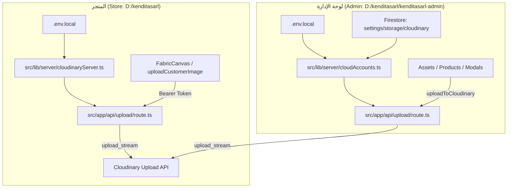

# تقرير تدقيق أمان وتدوير مفاتيح Cloudinary
**مشروع Kendin Tasarla (المتجر ولوحة الإدارة)**  
**المفتاح الجديد المراد تفعيله:** `kenditasarla-server-2026`  
**تاريخ التدقيق:** 2026-11-15  
**الحالة:** تدقيق آمن ومكتمل — بدون تعديل أي ملفات أو اتصال بخدمات حية

---

## 1. ملخص تنفيذي ونطاق الفحص

تم إجراء تدقيق أمني شامل لكافة استخدامات وإعدادات **Cloudinary** عبر المشروعين:
- **المتجر (Store):** `D:\kenditasarl`
- **لوحة الإدارة (Admin):** `D:\kenditasarl\kenditasarl-admin`

### أهم نتائج التدقيق:
1. **أمان تام للأسرار:** كافة عمليات رفع الصور واستدعاءات Cloudinary SDK محصورة في بيئة الخادم (Node.js Server-Side) بنسبة 100%. لا يوجد أي تسريب لمفاتيح أو أسرار في شفرات الواجهة الأمامية (Client Bundles)، أو حقول الردود في مسارات API، أو قواعد Firestore.
2. **استقلالية آلية اختيار الحساب:**
   - **المتجر:** يعتمد كلياً وثابتاً على متغيرات البيئة الخادمية.
   - **لوحة الإدارة:** تمتلك نظاماً ذكياً مزدوجاً: تقرأ الحساب النشط من قاعدة Firestore عبر مسار محمي ومغلق بالكامل (`/settings/storage/cloudinary`)، وفي حال عدم وجود أي حساب في القاعدة، تعود تلقائياً (Fallback) لمتغيرات البيئة.
3. **تنبيه جوهري حول صلاحية `Media Library User`:**
   - إن صلاحية `Media Library User` في نظام إدارة أدوار Cloudinary هي صلاحية مقيدة للمحتوى (Restricted Content Role).
   - المفتاح المزود بهذه الصلاحية **لا يملك وصولاً لأي مجلد افتراضياً** عبر الـ Upload API ما لم تُمنح له صلاحية `Contributor` على المجلدات المحددة، مما قد يؤدي لفشل الرفع البرمجي. يوضح هذا التقرير الخيارين المتاحين لمعالجة هذه النقطة بأمان.

---

## 2. خريطة استخدامات Cloudinary في المتجر والأدمن



### أولاً: في المتجر (`D:\kenditasarl`)
- **ملفات الإعداد الخادمي:**
  - [src/lib/server/cloudinaryServer.ts](file:///d:/kenditasarl/src/lib/server/cloudinaryServer.ts): يقرأ متغيرات البيئة الخادمية عبر `environmentAccount()` وينفذ `cloudinary.uploader.upload_stream`.
  - [src/lib/cloudinary.ts](file:///d:/kenditasarl/src/lib/cloudinary.ts): ملف قديم غير مستخدم في المسارات الحية يقرأ متغيرات البيئة.
  - [next.config.mjs](file:///d:/kenditasarl/next.config.mjs): يحتوي على إعداد نطاق العرض العام للصور `res.cloudinary.com` لتشغيل مكون `<Image />` في Next.js (بدون أي مفاتيح).
- **مسارات API:**
  - [src/app/api/upload/route.ts](file:///d:/kenditasarl/src/app/api/upload/route.ts): مسار الرفع المحمي. يتحقق من رمز Firebase (سواء كان مستخدماً مسجلاً أو زائر مجهول Guest)، ويفحص سلامة الصور وأحجامها عبر مكتبة `sharp` و`saxes`، ثم يرفع الملف إلى Cloudinary وينشئ إيصالاً آمناً في Firestore (`upload_receipts`).
- **مكونات الواجهة وتوليد المعاينات:**
  - [src/lib/uploadCustomerImage.ts](file:///d:/kenditasarl/src/lib/uploadCustomerImage.ts): دالة مساعدة في المتصفح ترسل الطلب إلى مسار `/api/upload` الداخلي مصحوباً برمز التفويض.
  - [src/components/editor/FabricCanvas.tsx](file:///d:/kenditasarl/src/components/editor/FabricCanvas.tsx): يستخدم الرفع عند قيام العميل بإدراج صورة خاصة في استوديو التصميم، أو عند حفظ معاينات أوجه المنتج (`previewImagesByFace`).

### ثانياً: في لوحة الإدارة (`D:\kenditasarl\kenditasarl-admin`)
- **ملفات الإعداد وإدارة الحسابات:**
  - [kenditasarl-admin/src/lib/server/cloudinaryServer.ts](file:///d:/kenditasarl/kenditasarl-admin/src/lib/server/cloudinaryServer.ts): مماثل للمتجر في تهيئة استدعاء `upload_stream`.
  - [kenditasarl-admin/src/lib/server/cloudAccounts.ts](file:///d:/kenditasarl/kenditasarl-admin/src/lib/server/cloudAccounts.ts): المحرك المركزي لاختيار الحساب؛ يفحص وجود وثيقة نشطة في Firestore تحت `/settings/storage/cloudinary`، وفي حال عدم وجودها يرجع لحساب البيئة `environmentAccount()`.
- **مسارات API الإدارية:**
  - [kenditasarl-admin/src/app/api/upload/route.ts](file:///d:/kenditasarl/kenditasarl-admin/src/app/api/upload/route.ts): مسار الرفع الإداري المحمي الذي يشترط دور `admin` أو `superadmin`.
  - [kenditasarl-admin/src/app/api/cloudinary/accounts/route.ts](file:///d:/kenditasarl/kenditasarl-admin/src/app/api/cloudinary/accounts/route.ts): واجهة إدارية تسمح بسرد الحسابات (إرجاع الاسم وحالة النشاط واسم السحابة فقط دون أسرار)، أو إضافة حساب جديد وتفعيله وحذفه.
- **واجهات وشاشات لوحة الإدارة:**
  - [kenditasarl-admin/src/app/(admin)/settings/cloudinary/page.tsx](file:///d:/kenditasarl/kenditasarl-admin/src/app/(admin)/settings/cloudinary/page.tsx): واجهة إدارية تفاعلية لإدارة حسابات التخزين السحابي والتبديل بينها بضغطة زر.
  - [kenditasarl-admin/src/lib/cloudinary-upload.ts](file:///d:/kenditasarl/kenditasarl-admin/src/lib/cloudinary-upload.ts): العميل البرمجي الذي يستدعيه الأدمن لرفع الصور.
  - شاشات الرفع: [assets/page.tsx](file:///d:/kenditasarl/kenditasarl-admin/src/app/(admin)/assets/page.tsx) (الملصقات والمطبوعات)، و[products/new/page.tsx](file:///d:/kenditasarl/kenditasarl-admin/src/app/(admin)/products/new/page.tsx) (صور المنتجات)، و[PrintAreaEditorModal.tsx](file:///d:/kenditasarl/kenditasarl-admin/src/components/admin/PrintAreaEditorModal.tsx).

---

## 3. آلية اختيار الحسابات وتعددها

| المشروع | آلية الاختيار | هل يدعم أكثر من حساب؟ | السلوك عند فقدان الإعداد |
|---|---|:---:|---|
| **المتجر (Store)** | عبر متغيرات البيئة فقط (`environmentAccount()`) | حساب واحد فقط في كل بيئة تشغيل | يلقي استثناء `storage_unconfigured` وتفشل عملية الرفع بخطأ 503 آمن دون كشف تفاصيل. |
| **لوحة الإدارة (Admin)** | ديناميكية عبر `activeAccount()` مع الرجوع للبيئة | نعم، يدعم تسجيل عدة حسابات في Firestore ولكن يتم تفعيل **حساب واحد نشط فقط** | إذا وُجد حساب نشط واحد يُستخدم، وإذا لم يوجد حساب نشط يعود تلقائياً لمتغيرات البيئة. وإذا تم تفعيل أكثر من حساب بالخطأ يُلقي استثناء `ambiguous_storage`. |

> [!NOTE]
> هذا التصميم المزدوج يسمح للمسؤول بإضافة المفتاح الجديد واختباره بالكامل من لوحة الإدارة وتفعيله بشكل ذري (Atomic Transaction) دون الحاجة لإعادة تشغيل الخادم فوراً أو المخاطرة بتعطيل المتجر.

---

## 4. أسماء متغيرات البيئة ومسارات الإعدادات التي يجب تحديثها

### أ. ملفات متغيرات البيئة (Environment Variables)
المتغيرات المطلوبة في كل من:
- `D:\kenditasarl\.env.local`
- `D:\kenditasarl\kenditasarl-admin\.env.local`
- إعدادات منصة الاستضافة الحية (Vercel / Cloud Run / VPS)

الأسماء الصريحة للمتغيرات (بدون قيم):
1. `CLOUDINARY_CLOUD_NAME` — اسم السحابة الخاص بحسابك على Cloudinary.
2. `CLOUDINARY_API_KEY` — المعرّف الرقمي العام للمفتاح الجديد (`kenditasarla-server-2026`).
3. `CLOUDINARY_API_SECRET` — السر الخاص بالمفتاح الجديد.

### ب. مسارات Firestore (في حال تفعيل الحساب عبر لوحة الإدارة)
- **مجموعة الحسابات:** `/settings/storage/cloudinary/{documentId}`
  - الحقول المخزنة داخل الوثيقة: `name`، `cloud_name`، `api_key`، `api_secret`، `is_active`، `created_at`.
- **قفل التعديل والمراجعة:** `/settings/storage`
  - الحقول: `changed_by`، `changed_at`.
- **قواعد الحماية ([firestore.rules](file:///d:/kenditasarl/firestore.rules)):**
  ```javascript
  match /settings/storage/{document=**} {
    allow read, write: if false; // محظور بالكامل على عملاء Firestore، متاح فقط عبر Firebase Admin SDK
  }
  ```

---

## 5. المجلدات المستهدفة وفحص صلاحية `Media Library User`

### أ. قائمة المجلدات (Folders) المستخدمة في المشروعين

| المجلد في Cloudinary | من يرفع إليه؟ | الغرض ونوع المحتوى | قيود الفحص الخادمي |
|---|---|---|---|
| `kenditasarl_products` | المتجر (Store) | صور العملاء الشخصية وتصميماتهم، ومعاينات الأوجه (`preview-*.jpg`) | مجلد إجباري ثابت للعملاء، يُمنع العميل من تجاوزه أو اختيار مجلد آخر. |
| `products/gallery` | الأدمن (Admin) | صور معارض المنتجات وصور المانيكان والألوان | حصري للأدمن، مسموح عبر القائمة البيضاء. |
| `stickers` | الأدمن (Admin) | ملفات المتجهات والملصقات الجاهزة (SVG) | حصري للأدمن، يتم التحقق الصارم من بنية XML لمنع ثغرات XSS. |
| `prints` | الأدمن (Admin) | تصاميم المطبوعات واللوحات الجاهزة (Raster / PNG) | حصري للأدمن، مسموح عبر القائمة البيضاء. |
| `kenditasarla` | الأدمن (Admin) | المجلد الاحتياطي الافتراضي في لوحة الإدارة | يُستخدم كبديل في حال عدم تمرير مجلد فرعي محدد. |

### ب. التحليل الفني لصلاحية `Media Library User` ومستوى المخاطرة

> [!WARNING]
> **تنبيه حاسم:** لقد قمت بإنشاء المفتاح الجديد بصلاحية `Media Library User`.
> في نظام الصلاحيات المحدث الخاص بـ Cloudinary:
> 1. دور **Media Library User** مخصص أصلاً لمستخدمي الواجهة الرسومية (UI Console)، وهو دور مقيد المحتوى (Restricted Content Principal).
> 2. عند استخدام مفتاح API يحمل هذا الدور برمجياً عبر الـ SDK (`uploader.upload_stream`)، فإن المفتاح **لا يملك وصولاً لأي مجلد افتراضياً (Zero Folders Access)**.
> 3. محاولة الرفع إلى مجلدات مثل `kenditasarl_products` أو `products/gallery` ستؤدي إلى رفض الطلب من قِبل سيرفرات Cloudinary بخطأ `401 Unauthorized` أو `403 Forbidden: Invalid permissions to upload to target folder`.

### جـ. التوصية لمعالجة الصلاحية (خيارات الحل):

- **الخيار الأول (الموصى به والأنسب برمجياً):**
  - ادخل إلى لوحة Cloudinary -> **Settings** -> **Access Keys** أو **User Management**.
  - قم بتغيير دور المفتاح `kenditasarla-server-2026` من `Media Library User` إلى **`Technical Admin`** (أو أنشئ المفتاح كـ **Product Environment Access Key** عادي).
  - هذا يمنح خادم Node.js صلاحية تنفيذ الرفع المباشر إلى كافة المجلدات المطلوبة للمتجر والأدمن دون تعقيدات مشاركة المجلدات.
- **الخيار الثاني (في حال الإصرار على صلاحية مقيدة):**
  - يجب الدخول إلى Media Library ومشاركة المجلدات الخمسة التالية مع المفتاح بصلاحية **`Contributor`** (أو أعلى) صراحة:
    1. `kenditasarl_products`
    2. `products/gallery`
    3. `stickers`
    4. `prints`
    5. `kenditasarla`
  - (أو مشاركة المجلد الرئيسي Root Folder بصلاحية Contributor).

---

## 6. التحقق من عدم بقاء أسرار مكشوفة في الكود أو الردود

أجرى الفحص مسحاً برمجياً دقيقاً لكافة الملفات عبر المستودعين وأثبت الآتي:
1. **لا توجد أي أسرار في الكود المصدري:** لا يوجد أي تضمين صريح لمفتاح أو سر Cloudinary في أي ملف شفرة (`.ts`, `.tsx`, `.js`, `.json`).
2. **استجابات مسار الرفع (`/api/upload`) نظيفة بالكامل:**
   - الرد المالي/الناجح يحتوي فقط على: `{ success: true, url, public_id }`.
   - ردود الأخطاء موحدة ولا تسرب أي تفاصيل داخلية: `{ error: "upload_failed" }`.
3. **استجابات إدارة الحسابات (`/api/cloudinary/accounts`) آمنة:**
   - دالة `listAccounts()` تنفذ `.select("name", "cloud_name", "is_active")`، وبالتالي فإن `api_key` و`api_secret` لا يتم إرسالهما مطلقاً إلى المتصفح.
4. **شجرة التخزين في Firestore مغلقة كلياً:**
   - تم التحقق من قاعدة الأمان `match /settings/storage/{document=**} { allow read, write: if false; }`، وهي تمنع أي قراءة أو كتابة عبر Client SDK حتى لو كان المستخدم يمتلك رمز تسجيل دخول.

---

## 7. الخطوات الآمنة الموصى بها لتنفيذ التدوير الذاتي (Step-by-Step Rotation)

نفّذ هذه الخطوات بنفسك وبالترتيب لضمان استمرار عمل المتجر بنسبة 100% دون أي انقطاع:

### الخطوة 1: ضبط صلاحية المفتاح في Cloudinary Console
1. افتح لوحة تحكم [Cloudinary Console](https://console.cloudinary.com/).
2. انتقل إلى **Settings** ثم **Access Keys** (أو **Users & Roles**).
3. حدد المفتاح الجديد `kenditasarla-server-2026`:
   - تأكد من تعديل دوره إلى **Technical Admin** أو تأكد من منحه صلاحية **Contributor** على المجلدات الخمسة المذكورة أعلاه.

### الخطوة 2: اختبار المفتاح الجديد في لوحة الإدارة أولاً (Zero Risk)
1. افتح لوحة الإدارة محلياً أو في المتصفح وتوجه إلى مسار:
   `https://[admin-domain]/settings/cloudinary` (أو `http://localhost:3001/settings/cloudinary`).
2. اضغط على زر **إضافة حساب (Add Account)**.
3. أدخل البيانات التالية:
   - **الاسم (Name):** `kenditasarla-server-2026`
   - **اسم السحابة (Cloud Name):** اسم سحابتك الحالية.
   - **مفتاح API (API Key):** المفتاح الجديد.
   - **السر (API Secret):** السر الخاص بالمفتاح الجديد.
4. اضغط **حفظ (Save)**.
5. سيظهر الحساب الجديد في القائمة. اضغط على زر **تفعيل (Activate)** بجانبه.
6. **اختبار الرفع:**
   - انتقل إلى صفحة **الأصول (Assets)** في الأدمن وجرب رفع ملصق SVG أو صورة مطبوعة تجريبية.
   - إذا تم الرفع بنجاح وحصلت على الرابط: هذا يثبت بنسبة 100% أن المفتاح الجديد سليم وأن صلاحياته تغطي المجلدات المطلوبة.
   - *في حال حدوث أي خطأ في الصلاحيات:* اضغط فوراً على **تفعيل (Activate)** بجانب الحساب القديم ليعود النظام للعمل في جزء من الثانية دون أي ضرر.

### الخطوة 3: تحديث متغيرات البيئة في المتجر والأدمن
بعد نجاح الاختبار في الخطوة 2:
1. افتح ملف `D:\kenditasarl\.env.local` وحدّث:
   - `CLOUDINARY_API_KEY=[المفتاح_الجديد]`
   - `CLOUDINARY_API_SECRET=[السر_الجديد]`
2. افتح ملف `D:\kenditasarl\kenditasarl-admin\.env.local` وحدّث القيمتين المماثلتين.
3. حدّث المتغيرات على منصة الاستضافة الحية (Vercel / Cloud Run).
4. افتح المتجر وتوجه إلى استوديو التصميم (`/design-studio`) وقم بتجربة رفع صورة شخصية على التيشيرت للتأكد من نجاح رفع المتجر.

### الخطوة 4: فترة المراقبة (24 إلى 48 ساعة)
- **لا تعطل المفاتيح القديمة فوراً.**
- اترك المفاتيح القديمة صالحة لمدة 24–48 ساعة للتأكد من عدم وجود جلسات سابقة أو مهام خلفية متأخرة.

### الخطوة 5: تعطيل المفاتيح القديمة ثم حذفها
1. ادخل إلى Cloudinary Console -> **Access Keys**.
2. اختر المفاتيح القديمة واضغط أولاً على **Disable (تعطيل)**.
3. راقب لوحة تحكم المتجر والطلبات لعدة ساعات.
4. بعد التأكد التام من استقرار العمليات، اضغط **Delete (حذف نهائي)** للمفاتيح القديمة.
5. (اختياري) في صفحة إعدادات التخزين بالأدمن `/settings/cloudinary`، يمكنك حذف بطاقة الحساب القديم عبر زر **حذف (Remove)** لتنظيف السجل في Firestore.

---

## 8. الخاتمة والالتزام بشروط التوقف

- تم توثيق كامل البنية بدقة وموضوعية.
- لم يتم كشف أو تضمين أي أسرار في هذا التقرير.
- تم التوقف التام عند هذا الحد بانتظار توجيهاتك.
