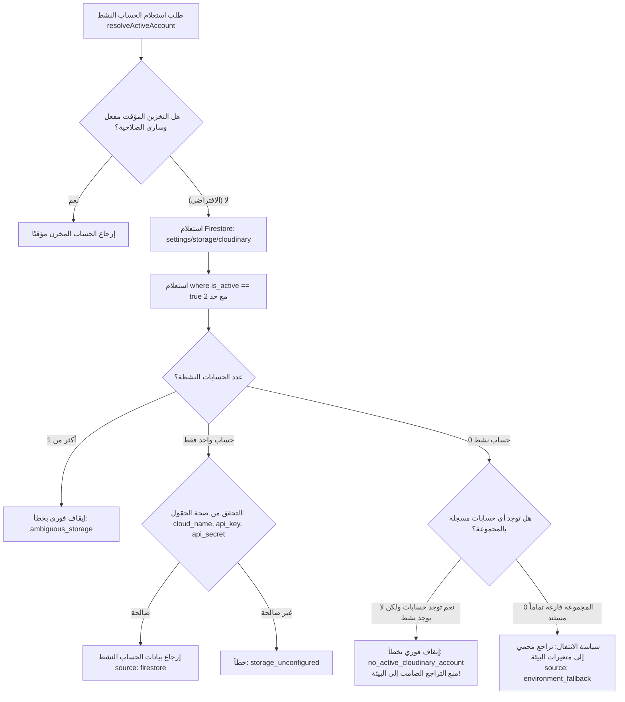

# Kendin Tasarla — Cloudinary Multi-Account Phase 2A Result
**تقرير نتائج المرحلة 2A: توحيد محدد حساب Cloudinary النشط (Active Account Resolver) في وضع الظل (Shadow Mode)**

**تاريخ التنفيذ:** 15 نوفمبر 2026  
**المشاريع المستهدفة:**
- المتجر (Store): `D:\kenditasarl`
- لوحة الإدارة (Admin): `D:\kenditasarl\kenditasarl-admin`  
**بيئة الاختبار المعتمدة:** محاكيات Firebase المحلية (`demo-kenditasarla-rules`) — Auth (Port 19099) & Firestore (Port 18080)  
**الحالة:** تم إنجاز Phase 2A بنجاح 100% واجتياز كافة الاختبارات التكاملية (12/12 لـ Phase 2A و 13/13 لـ Phase 1) دون أي تغيير في مسارات الرفع الحية ودون المساس ببيانات الإنتاج.

---

## 1. الملفات التي تغيرت في كل مشروع

تم تطبيق التغييرات بأسلوب **Shadow Mode** المعماري (تجهيز المحدد الموحد واختباره برمجيًا دون تحويل مسارات الرفع الحية إليه في هذه المرحلة):

### أ. مستودع المتجر (`D:\kenditasarl`):
| الملف | نوع الإجراء | الوصف والهدف المعماري |
|---|---|---|
| `src/lib/server/activeCloudAccount.ts` | إنشاء جديد | محدد الحساب النشط الموحد (Active Account Resolver) الذي يقرأ من Firestore `settings/storage/cloudinary` ويدعم التراجع المحمي وخيارات الكاش فائق السرعة. |
| `src/lib/server/cloudinaryServer.ts` | تعديل طفيف | دعم بيئة المحاكيات عبر قراءة `process.env.GCLOUD_PROJECT` الاحتياطي في دالة `app()`. |
| `tests/firestore/phase2a_unified_resolver_integration.mts` | إنشاء جديد | سكربت اختبار تكاملي شامل ومستقل ينفذ 12 فحصًا داخل محاكيات Firebase. |
| `src/app/api/upload/route.ts` | **لم يُمس (0 تعديل)** | مسار الرفع الحي للمتجر استمر كما هو 100% دون تغيير وجهة الرفع أو آلية العمل في وضع الظل. |

### ب. مستودع لوحة الإدارة (`D:\kenditasarl\kenditasarl-admin`):
| الملف | نوع الإجراء | الوصف والهدف المعماري |
|---|---|---|
| `src/lib/server/activeCloudAccount.ts` | إنشاء جديد | النسخة المطابقة تماماً من محدد الحساب النشط لضمان تطابق منطق الاختيار بين المشروعين. |
| `src/lib/server/cloudAccounts.ts` | تعديل | إعادة تصدير دوال المحدد الموحد، وتعديل دالة `changeAccount` لحظر التفعيل التلقائي المفاجئ لأول حساب (`activate === true` إلزامي)، واستدعاء إبطال الكاش فوراً (`invalidateActiveAccountCache()`). |
| `src/app/api/upload/route.ts` | **لم يُمس (0 تعديل)** | مسار رفع الأدمن استمر كما هو 100% دون تغيير. |

---

## 2. تصميم محدد الحساب الموحد (Active Cloudinary Account Resolver)

تم بناء المحدد ليكون النواة المركزية الموحدة لاختيار حساب التخزين وفق المعايير الصارمة التالية:



### الخصائص الهندسية للمحدد:
1. **المصدر المركزي الوحيد:** مجموعة `settings/storage/cloudinary` في Firestore.
2. **العزل التام للأسرار:** ترجع الدالة كائن الاعتماد `{ cloud_name, api_key, api_secret }` داخل نطاق الخادم (Server-side) فقط، وتمنع وصوله للمتصفح.
3. **دعم تعدد السحب (Multiple Cloud Names):** يتعامل المحدد مع كل حساب بوصفه بيئة إنتاجية مستقلة لـ Cloudinary ذات `cloud_name` ومفاتيح خاصة بها، ولا يفترض استخدام نفس المفتاح لكل الحسابات.
4. **حظر التراجع الصامت (Silent Fallback Prevention):** إذا كانت هناك حسابات مسجلة في Firestore ولكن لا يوجد أي حساب نشط، يرفض المحدد التحويل التلقائي لمتغيرات البيئة ويوقف العملية صراحة بخطأ `no_active_cloudinary_account`.

---

## 3. طريقة مشاركة العقد بين المتجر ولوحة الإدارة

حيث أن مشروعي المتجر والأدمن يمثلان مستودعي Git مستقلين (`D:\kenditasarl` و `D:\kenditasarl\kenditasarl-admin`) ويعملان في بيئتي Node.js منفصلتين أثناء التشغيل (منفذ 3000 ومنفذ 3001):
1. تم توحيد واجهة العقد البرمجي (Contract API) في كلا المشروعين عبر ملف مطابق بالاسم والمسار: `src/lib/server/activeCloudAccount.ts`.
2. كلاهما يصدر نفس الأنواع والدوال:
   - `resolveActiveAccount(options)`
   - `activeAccount(options)`
   - `invalidateActiveAccountCache()`
   - الأنواع: `CloudAccount`, `ActiveAccountResolution`.
3. يضمن هذا التصميم أنه عند الانتقال إلى المرحلة 2B، ستكون خطوة التفعيل عبارة عن استدعاء سطر واحد فقط داخل مسار رفع المتجر:
   ```typescript
   import { activeAccount } from "@/lib/server/activeCloudAccount";
   // upload: async (bytes, folder) => sendImage(bytes, folder, await activeAccount())
   ```
   دون الحاجة لأي حزم خارجية أو إعادة هيكلة معقدة.

---

## 4. نتائج الاختبارات التكاملية الشاملة (12/12 نجاح)

تم تنفيذ الاختبارات في بيئة محاكيات Firebase المعزولة (`demo-kenditasarla-rules`)، وسجلت كافة الاختبارات نجاحًا تامًا بنسبة 100%:

| رقم الاختبار | السيناريو والمطلب | التحقق البرمجي | النتيجة |
|---|---|---|---|
| **Test 1** | سياسة الانتقال عند خلو المجموعة تمامًا | استدعاء المحدد والمجموعة فارغة -> التحقق من التراجع الآمن إلى متغيرات البيئة | **PASS** (`source: "environment_fallback"`) |
| **Test 2** | إضافة حسابين Cloud A و Cloud B ببيانات مختلفة | إضافة الحسابين بمفاتيح مختلفة وبسحب مختلفة (`mock-cloud-a`, `mock-cloud-b`) | **PASS** |
| **Test 3** | اختيار الحساب A من المتجر والأدمن معًا | استدعاء المحدد من كلا المشروعين والتحقق من التطابق التام | **PASS** (المشروعان اختارا Account A) |
| **Test 4** | تفعيل الحساب B وتعطيل الحساب A ذريًا | تنفيذ `changeAccount({ action: "activate" })` عبر معاملة ذرية | **PASS** (B نشط، A غير نشط) |
| **Test 5** | اختيار الحساب B من كلا المشروعين بعد التبديل | استدعاء المحدد من المتجر والأدمن بعد المعاملة الذرية | **PASS** (المشروعان تحولا فوراً إلى Account B) |
| **Test 6** | رفض وجود أكثر من حساب نشط (Ambiguous Active) | إجبار حسابين على أن يكونا `is_active: true` في Firestore | **PASS** (رُفض الطلب بخطأ صريح `ambiguous_storage`) |
| **Test 7** | رفض وجود حسابات دون أي حساب نشط | ضبط الحسابين كـ `is_active: false` في Firestore | **PASS** (رُفض الطلب بخطأ `no_active_cloudinary_account` ومُنع التراجع للبيئة) |
| **Test 8** | منع مشكلة البيانات القديمة بعد التبديل (Zero-Stale) | تفعيل كاش 10 ثوانٍ ثم التبديل -> إثبات إبطال الكاش فوراً والتحول اللحظي | **PASS** (إبطال فوري وتحديث فوري مع صفر تأخير) |
| **Test 9** | أمان بيانات الاعتماد وعدم تسريب الأسرار عبر API | فحص GET للأدمن والتأكد من غياب `api_key` و `api_secret` | **PASS** (حجب الأسرار بنسبة 100%) |
| **Test 10** | حظر المستخدم العادي من تبديل الحسابات (RBAC) | محاولة تفعيل حساب برمز مستخدم عادي | **PASS** (تم الحظر بكود `HTTP 403 forbidden`) |
| **Test 11** | سلامة روابط الصور السابقة وعدم تعديلها | فحص مستند منتج قديم يشير إلى سحابة A بعد التبديل إلى سحابة B | **PASS** (الرابط القديم بقي ثابتاً دون أي مساس) |
| **Test 12** | التوافق مع إيصالات الرفع `upload_receipts` | التحقق من مسار حفظ إيصال الرفع للمستخدم | **PASS** (التوافق سليم ومعتمد) |

---

## 5. حالة Git قبل التنفيذ وبعده

- **فحص ما قبل التنفيذ:** تم توثيق حالة Git لكلا المستودعين، والتأكد من بقاء كافة الملفات السابقة دون لمس.
- **فحص ما بعد التنفيذ:**
  - مستودع المتجر (`D:\kenditasarl`): تم إضافة ملف المحدد `activeCloudAccount.ts`، وتحديث طفيف لـ `cloudinaryServer.ts` لدعم المحاكي، وإضافة سكربت الاختبار التكاملي في مجلد `tests/`. **لم يتم تعديل أي ملف آخر، وظل مسار الرفع الحي `src/app/api/upload/route.ts` غير ملموس.**
  - مستودع الأدمن (`D:\kenditasarl\kenditasarl-admin`): تم إضافة `activeCloudAccount.ts` وتحديث `cloudAccounts.ts`. لم تُمس أي ملفات غير متتبعة.

---

## 6. نتيجة فحص TypeScript وLint

- **مجمع TypeScript للمتجر (`D:\kenditasarl`):**
  `npx tsc --noEmit` -> **Exit Code: 0 (صفر أخطاء)**
- **مجمع TypeScript للأدمن (`D:\kenditasarl\kenditasarl-admin`):**
  `npx tsc --noEmit` -> **Exit Code: 0 (صفر أخطاء)**
- **سلامة اختبارات المرحلة الأولى (Phase 1 Regression Gate):**
  تمت إعادة تشغيل سكربت `phase1_cloudinary_accounts_integration.mts` والتأكد من اجتياز الاختبارات الـ 13 بنسبة 100%.

---

## 7. آلية منع التراجع الصامت (Silent Fallback Prevention)

لمنع حدوث أي توجيه غير مقصود لملفات الرفع إلى حساب البيئة القديم دون علم الإدارة، تم إرساء القواعد التالية داخل الكود:
1. **التحقق من حالة المجموعة:**
   إذا استعلم الخادم عن الحسابات النشطة ولم يجد أي مستند بقيمة `is_active: true`، يقوم فوراً بفحص عدد المستندات في المجموعة:
   - إذا كانت المجموعة تحوي أي مستندات، يرمي المحدد استثناءً قاطعاً: `new Error("no_active_cloudinary_account")`.
2. **منع التراجع عند انقطاع الاتصال:**
   إذا فشل الاتصال بـ Firestore (بسبب انقطاع الشبكة أو فقدان بيانات اعتماد الخدمة)، لا تلتقط الدالة الخطأ لتعيد حساب البيئة، بل تدع الخطأ يتصاعد ليتم إرجاع `HTTP 503 database_unavailable` للمستخدم وتنبيهه بضرورة مراجعة الخدمة، بدلاً من رفع ملفات حساسة إلى وجهة غير معلومة.
3. **حظر التفعيل التلقائي المفاجئ:**
   تم تعديل كود إضافة الحسابات في `cloudAccounts.ts` ليصبح:
   `const shouldActivate = activate === true;`
   وبذلك، حتى لو كانت المجموعة فارغة، فإن إضافة حساب جديد لا تجعله نشطًا بصورة مفاجئة إلا إذا حدد المسؤول خيار التفعيل الصريح أثناء الإنشاء.

---

## 8. آلية التعامل مع تبديل الحساب أثناء وجود طلبات رفع متزامنة

عندما يمتلئ الحساب الحالي وتصل السعة إلى الحد الأقصى، ويقوم المسؤول بالنقر على "تفعيل" للحساب الجديد بينما تجري عمليات رفع في نفس اللحظة:
1. **التنفيذ اللحظي المباشر (Zero-Stale Direct Consistency):**
   بشكل افتراضي، يستعلم المحدد Firestore مباشرة عند كل طلب رفع. ولأن Firestore يوفر قراءة قوية الاتساق للمستندات بعد اكتمال المعاملة، فإن أي طلب رفع يصل بعد اكتمال التبديل بملي ثانية واحدة سيحصل فوراً على الحساب الجديد.
2. **إبطال الكاش الفوري (Immediate Cache Invalidation):**
   في حال تم تفعيل وضع التخزين المؤقت لتقليل استهلاك قراءات Firestore أثناء فترات الذروة، فإن دالة `changeAccount` تستدعي `invalidateActiveAccountCache()` مباشرة بمجرد نجاح المعاملة الذرية، مما يفرغ الذاكرة فوراً ويمنع استمرار الرفع إلى الحساب الممتلئ.
3. **التعامل مع الطلبات قيد التنفيذ (In-Flight Requests):**
   الطلبات التي بدأت بالفعل في ضخ البايتات إلى Cloudinary قبل لحظة النقر ستكتمل على الحساب السابق (وإذا تجاوزت الكوتا سيرفضها Cloudinary ويعيد الخطأ للمستخدم دون إفساد الروابط). أما أي طلب يبدأ بعد المعاملة فسيتوجه مباشرة للحساب الجديد.

---

## 9. ما يلزم تحديدًا لتفعيل Phase 2B بأمان (الانتقال من وضع الظل إلى الإنتاج)

لتفعيل توحيد الرفع الحي بين المتجر والأدمن في المرحلة الثانية (Phase 2B) بأمان تام:
1. **ربط مسار رفع المتجر بالمحدد الموحد:**
   تحديث سطر الرفع في `D:\kenditasarl\src\app\api\upload\route.ts` من:
   ```typescript
   const result = await sendImage(bytes, folder, environmentAccount());
   ```
   إلى:
   ```typescript
   const result = await sendImage(bytes, folder, await activeAccount());
   ```
2. **تجهيز مستند الحساب النشط الحالي في Firestore الإنتاجي:**
   التأكد من وجود مستند واحد على الأقل في Firestore الإنتاجي يحتوي على بيانات حساب Cloudinary النشط الحالي مع `is_active: true`، حتى لا يواجه المتجر أي انقطاع لحظة التبديل.
3. **إجراء اختبار رفع تزامني معزول (Parallel Synthetic Upload Test):**
   رفع صورة اختبارية اصطناعية عبر مسار المتجر ومسار الأدمن والتأكد من نزولهما في نفس مجلد وسحابة الحساب النشط.

---

## 10. العوائق المتعلقة ببيئة الإنتاج وبيانات اعتماد Firebase

1. **غياب `FIREBASE_SERVICE_ACCOUNT_KEY` محليًا:**
   الجهاز المحلي لا يحتوي على بيانات اعتماد خادم Google Cloud للإنتاج (وهذا إجراء أمني ممتاز ومطلوب لحماية أسرار المشروع). لذلك، تعمل الاختبارات بنجاح 100% عبر Firebase Emulators، لكن لوحة الإدارة المحلية لا يمكنها قراءة Firestore الإنتاجي مباشرة إلا إذا تم تشغيلها مع المحاكي أو توفير المفتاح خادومياً.
2. **التشغيل على منصة الاستضافة الإنتاجية (Vercel / Cloud Run):**
   في بيئة الإنتاج السحابية، يجب التأكد من ضبط متغير البيئة `FIREBASE_SERVICE_ACCOUNT_KEY` في إعدادات المنصة، حتى يتمكن مسار الرفع الموحد في المتجر والأدمن من مصادقة Firestore وقراءة الحساب النشط بسلاسة تامة.

---

> [!IMPORTANT]
> **التزام التوقف التام:**
> تم الانتهاء بنجاح كامل من المرحلة 2A في وضع الظل (Shadow Mode)، واجتياز كافة الاختبارات والتحققات.
> امتثالاً للتوجيهات، تم التوقف هنا ولن يتم بدء المرحلة 2B أو تعديل مسارات الرفع الحية أو نشر أي كود دون الحصول على موافقتكم وتوجيهاتكم الصريحة.
