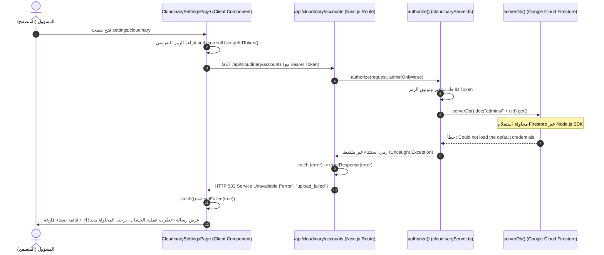
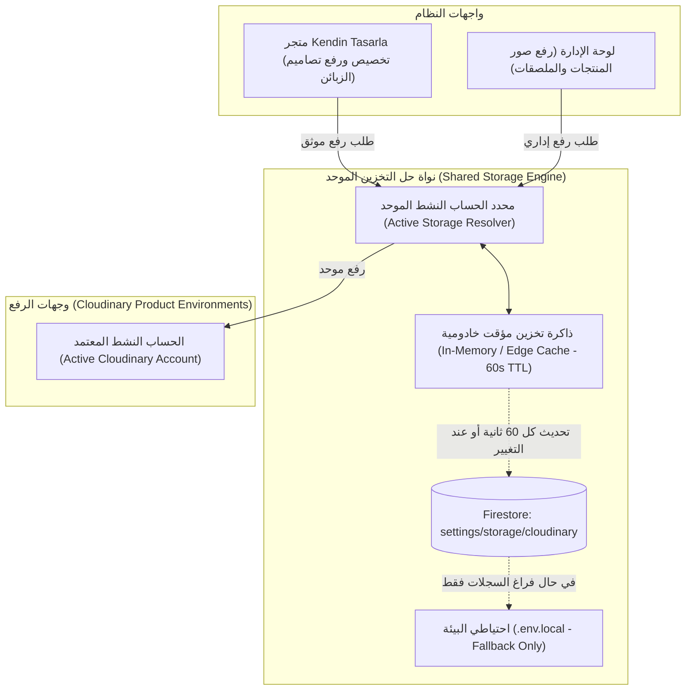

# Kendin Tasarla — Cloudinary Multi-Account Recovery Audit
**تقرير التشخيص الجذري والشامل لتعطل قائمة حسابات Cloudinary في لوحة الإدارة**

**تاريخ التقرير:** 15 نوفمبر 2026  
**المشروع المستهدف:** `D:\kenditasarl\kenditasarl-admin`  
**الصفحة المستهدفة:** `http://localhost:3001/settings/cloudinary`  
**الحالة:** تشخيص تحليلي للقراءة فقط (Read-Only) مع الحفاظ التام على أمان بيانات الإنتاج

---

## 1. الملخص التنفيذي والإجابات المباشرة على الأسئلة الثمانية

بناءً على الفحص المعماري الدقيق لملفات الواجهة والـ API والـ Server Libraries وسجلات Git وبيئة التطوير المحلية، نلخص الإجابات المباشرة كما يلي:

| # | السؤال المطروح | النتيجة والتشخيص الدقيق |
|---|---|---|
| **1** | **لماذا تفشل عملية `GET /api/cloudinary/accounts`؟** | تفشل لأن مسار الـ API يعمل من جانب الخادم (Node.js) ويستدعي دالة `authorize(request, true)` التي تنفذ استعلام Firestore Admin SDK عبر `serverDb().doc('admins/${uid}').get()`. خادم التطوير المحلي (`localhost:3001`) لا يملك بيانات اعتماد خادم Google Cloud (`FIREBASE_SERVICE_ACCOUNT_KEY` فارغة ولا توجد ADC على الجهاز)، مما يؤدي لرمي خطأ Node.js: `Could not load the default credentials`. |
| **2** | **ما كود HTTP الفعلي للاستجابة؟** | كود الاستجابة الفعلي هو **`HTTP 503 Service Unavailable`**، مع جسم استجابة بصيغة JSON: `{"error": "upload_failed"}` (وهذا ناتج عن استعارة دالة `errorResponse` الخاصة بمسار رفع الصور). |
| **3** | **هل الفشل بسبب Firebase Admin credentials أم المصادقة أم الصلاحيات؟** | الفشل يرجع حصرًا إلى **غياب Firebase Admin Credentials (`FIREBASE_SERVICE_ACCOUNT_KEY`)** على بيئة الخادم المحلي. مصادقة العميل (Client Auth) وصلاحيات الأدمن على المتصفح سليمة بدليل تمكنه من فتح لوحة الأدمن وتخطي فحص `hasAdminMembership`، لكن كود الخادم يعجز عن التحقق من صلاحيات المدير في Firestore الإنتاجي لعدم وجود مفتاح الخدمة الإداري. |
| **4** | **هل الواجهة تفسر فشل API خطأً على أنه قائمة حسابات فارغة؟** | **نعم وبشكل غير مباشر:** الواجهة تبدأ بحالة `accounts = []`. عند فشل استدعاء API برمز 503، يلتقط الـ `.catch()` الخطأ ويضبط `failed = true`، وتتحول `busy` إلى `false`. لا يتم عرض نص "لا توجد حسابات"، ولكن لأن مصفوفة `accounts` بقيت فارغة، يظهر جدول الحسابات أبيض وفارغًا تحت رسالة الخطأ الحمراء «تعذّرت عملية الحساب. يرجى المحاولة مجددًا». |
| **5** | **هل حدث Regression في الواجهة أو مسارات API بعد التحديثات الأخيرة؟** | **نعم، حدث تراجع في بيئة التطوير المحلية:** سابقًا كانت الواجهة تستعلم Firestore مباشرة من المتصفح (Client SDK) وكانت تعرض الحسابات وتكشف سر الـ API (`api_secret`) في المتصفح. تم تحديث الصفحة مؤخرًا لتعزيز الأمان ونقل جلب الحسابات وإخفاء الأسرار إلى خادم Next.js، لكن لم يتم توفير محاكيات أو بيئة اعتماد للخادم المحلي، فتحولت الميزة من وضع كان يعمل محليًا (بشكل غير آمن) إلى شلل تام محليًا لغياب مفاتيح الخادم. |
| **6** | **هل ما زال دعم تعدد الحسابات وتفعيل حساب واحد موجودًا في الكود بالفعل؟** | **نعم، 100% بدون أي نقصان.** الكود الموجود في `src/lib/server/cloudAccounts.ts` يحتوي على المنطق الكامل: `listAccounts`، `changeAccount` (إضافة وتفعيل وحذف عبر معامَلة ذرية `runTransaction` تضمن تفعيل حساب واحد فقط)، و`activeAccount`. لم يُحذف أي سطر من منطق تعدد الحسابات، وإنما تعطل الوصول إليه محليًا. |
| **7** | **هل فشل Firestore يؤدي إلى استخدام مفتاح البيئة احتياطيًا وتغيير وجهة الرفع دون علم المسؤول؟** | **لا في حالة الخطأ، ونعم في حالة المجموعة الفارغة:** إذا فشل اتصال Firestore بخطأ برمجي أو شبكي، ترمي دالة `activeAccount()` خطأً صريحًا وتتوقف عملية الرفع ولا يحدث تراجع صامت. **ولكن** إذا نجح الاتصال وكانت مجموعة `settings/storage/cloudinary` فارغة تمامًا، فإنها ترجع تلقائيًا إلى `environmentAccount()` (`.env.local`). |
| **8** | **هل يوجد اختلاف بين آلية الرفع في المتجر والأدمن يسبب تخزين الصور في حسابين مختلفين؟** | **نعم، يوجد انقسام خطير وغير متزامن (Split-Storage Desynchronization):** مسار الأدمن (`kenditasarl-admin/src/app/api/upload/route.ts`) يستخدم `await activeAccount()` المرتبط بـ Firestore، بينما مسار المتجر (`kenditasarl/src/app/api/upload/route.ts`) يستخدم حصرًا ومباشرة `environmentAccount()` من ملف `.env.local`. هذا يعني أنه عند تبديل الحساب النشط من الأدمن، ستُرفع صور الأدمن إلى الحساب الجديد بينما تصاميم وتخصيصات زبائن المتجر ستستمر بالرفع إلى الحساب القديم المحدد بملف البيئة! |

---

## 2. التحليل التفصيلي للسبب الجذري ومسار تنفيذ الطلب (Execution Flow)

### أ. دورة حياة الطلب على `http://localhost:3001/settings/cloudinary`


### ب. المقارنة الحاسمة: لماذا فتحت لوحة الأدمن بينما فشلت صفحة التخزين؟
- **فحص عضوية الأدمن في تخطيط اللوحة (`src/lib/adminMembership.ts`):**
  تستخدم اللوحة كود العميل المباشر:
  ```typescript
  export async function hasAdminMembership(uid: string): Promise<boolean> {
    const membership = await getDocFromServer(doc(db, "admins", uid));
    const role = membership.data()?.role;
    return role === "admin" || role === "superadmin";
  }
  ```
  هذا الاستدعاء يعمل داخل المتصفح عبر بروتوكول WebChannel/gRPC-Web مستخدمًا `NEXT_PUBLIC_FIREBASE_API_KEY` وجلسة المستخدم الحية. تسمح قواعد حماية Firestore (`firestore.rules`) للمستخدم بقراءة مستند `admins/{uid}` الخاص به. لذلك ينجح فتح اللوحة وتصفح الروابط.
- **فحص الصلاحيات داخل مسار API (`src/lib/server/cloudinaryServer.ts`):**
  المسار الجديد يعتمد كليًا على بيئة الخادم:
  ```typescript
  if (adminOnly) {
    const role = (await serverDb().doc(`admins/${uid}`).get()).get("role");
    if (role !== "admin" && role !== "superadmin") return 403;
  }
  ```
  حيث `serverDb()` تستدعي `getFirestore(app())`. وحيث أن خادم Next.js المحلي لا يحتوي على `FIREBASE_SERVICE_ACCOUNT_KEY` في متغيرات البيئة، تحاول مكتبة `@google-cloud/firestore` البحث عن بيانات اعتماد خادم سحابي افتراضية (GCP Metadata Service أو ADC). ولأن الجهاز المحلي بيئة تطوير عادية بدون ADC، ينهار الاتصال فورًا قبل حتى أن يصل الكود إلى دالة `listAccounts()`.

---

## 3. أسماء الملفات والدوال والمسارات المسؤولة

| المسار والملف | الدالة / الكائن | طبيعة المسؤولية في الخلل |
|---|---|---|
| `kenditasarl-admin/src/app/(admin)/settings/cloudinary/page.tsx` | `accountRequest()` | إرسال الطلب وإدارة الحالة؛ تبتلع تفاصيل الخطأ في `.catch(() => setFailed(true))` ولا تميز بين انقطاع الاتصال وفراغ البيانات. |
| `kenditasarl-admin/src/app/api/cloudinary/accounts/route.ts` | `handle()` | معالج طلبات GET و POST؛ يستورد `errorResponse` المخصصة للرفع مما ينتج عنه رمز 503 ورسالة `upload_failed` غير ملائمة لإدارة الحسابات. |
| `kenditasarl-admin/src/lib/server/cloudinaryServer.ts` | `app()` و `authorize()` و `serverDb()` | نقطة الانهيار الجذرية: غياب الاعتماد لخادم Firestore عند الاتصال ببيئة غير بيئة المحاكيات. |
| `kenditasarl-admin/src/lib/server/cloudAccounts.ts` | `listAccounts()` و `activeAccount()` | منطق إدارة الحسابات السحابية والتفعيل الأحادي؛ سليم معماريًا ومحمي، لكنه معطل بسبب تعطل الطبقة السابقة. |
| `kenditasarl-admin/src/lib/server/imageUpload.ts` | `errorResponse()` | تُرجع كود 503 بصورة ثابتة عند التقاط أي خطأ عام غير متوقع. |
| **مسار الرفع بالمتجر:** `kenditasarl/src/app/api/upload/route.ts` | `POST()` | استخدام مباشر لـ `environmentAccount()` بدلاً من `activeAccount()`، مسببًا انفصالاً تامًا عن الحسابات النشطة في Firestore. |
| **مسار الرفع بالأدمن:** `kenditasarl-admin/src/app/api/upload/route.ts` | `POST()` | يعتمد على `await activeAccount()`، مما يخلق تضاربًا مزدوجًا مع المتجر. |

---

## 4. شرح سبب اختفاء الحسابات من الواجهة (UI Failure Analysis)

### تفكيك حالة الصفحة في `page.tsx`:
```typescript
const [accounts, setAccounts] = useState<Account[]>([]);
const [busy, setBusy] = useState(true);
const [failed, setFailed] = useState(false);

useEffect(() => {
  setMessages(storageMessages());
  setLocale(storageLocale());
  accountRequest()
    .then(setAccounts)
    .catch(() => setFailed(true))
    .finally(() => setBusy(false));
}, []);
```

1. **القيمة الابتدائية:** تبدأ `accounts` كمصفوفة فارغة `[]`، وتكون `busy = true` و `failed = false`.
2. **فشل الاستجابة:** يرمي `fetch` استثناءً لأن السيرفر أجاب بـ `HTTP 503`.
3. **تنفيذ الـ Catch:** يتم تنفيذ `setFailed(true)`. مصفوفة `accounts` لا تتلقى أي قيمة وتبقى `[]`.
4. **تنفيذ الـ Finally:** تتحول `busy` إلى `false`.
5. **رندر الواجهة:**
   - الشرط الأول: `{failed && <p role="alert" className="text-red-700">{messages.error}</p>}` يتحقق، فتظهر العبارة:
     **«تعذّرت عملية الحساب. يرجى المحاولة مجددًا.»**
   - الشرط الثاني: `{!busy && !failed && !accounts.length && <p>{messages.empty}</p>}` **لا يتحقق** لأن `failed` أصبحت `true`، لذلك تختفي رسالة "لا توجد حسابات محفوظة".
   - رندر القائمة: `{accounts.map(account => ...)}` لا يرسم أي عنصر لأن المصفوفة طولها `0`.
   - **النتيجة أمام المستخدم:** يرى صندوق إدارة الحسابات فارغًا، مع زر "+ إضافة حساب" ورسالة الخطأ الحمراء بالأعلى، فيبدو كأن الحسابات تم مسحها أو اختفت من النظام.

---

## 5. حالة دعم تعدد الحسابات الحالية والأمان

### أ. هل تم إلغاء تعدد الحسابات؟
**قطعيًا لا.** الكود في `src/lib/server/cloudAccounts.ts` مبني باحترافية عالية ويحقق المتطلبات المعمارية:
1. **دعم إضافة حسابات متعددة:** عبر `action: "add"`.
2. **عرض الحسابات الآمن:** دالة `listAccounts()` ترجع فقط:
   ```typescript
   { id: doc.id, name: doc.get("name"), cloud_name: doc.get("cloud_name"), is_active: doc.get("is_active") }
   ```
   وهذا يمنع كشف `api_key` أو `api_secret` في استجابة الشبكة للمتصفح نهائيًا.
3. **التفعيل الأحادي الصارم (Strict Single Active Guarantee):**
   تستخدم دالة `changeAccount` معامَلة ذرية (`serverDb().runTransaction`):
   ```typescript
   for (const doc of docs.docs) {
     const active = doc.id === input.id;
     if (active !== doc.get("is_active")) tx.update(doc.ref, { is_active: active });
   }
   ```
   يتم تحديث جميع المستندات في عملية ذرية واحدة: الحساب المختار يصبح `is_active: true`، وجميع الحسابات الأخرى تصبح فورًا `is_active: false`.
4. **الحذف الآمن:** إمكانية حذف حساب عبر `action: "remove"` دون التأثير على روابط الصور السابقة.

---

## 6. خطة إصلاح الواجهة ومسار API دون المساس بالإنتاج

لإعادة النظام للعمل بكفاءة دون تعديل أي بيانات إنتاجية أو تعريض النظام لأي ثغرة:

### الخطوة 1: تحسين مسار الـ API (`/api/cloudinary/accounts/route.ts`)
- فصل استجابات الخطأ وتحديد أكواد HTTP المعيارية:
  - رمز `401 Unauthorized` إذا كانت الجلسة مفقودة أو منتهية.
  - رمز `403 Forbidden` إذا كان المستخدم ليس مديرًا في `admins/{uid}`.
  - رمز `500 Internal Server Error` (وليس 503 upload_failed) عند حدوث خطأ في الاتصال بقاعدة البيانات مع إرجاع كود تفصيلي: `{ error: "database_unavailable" }`.

### الخطوة 2: تحسين تجربة واجهة المستخدم (`page.tsx`)
- توفير واجهة حالة خطأ واضحة (Error Boundary / Retry UI) تحتوي على:
  - زر "إعادة المحاولة" (Retry) لإعادة تنفيذ `accountRequest()`.
  - عدم إخفاء الهيكل وإظهار رسالة توضح أن الخلل في جلب البيانات وليس في فراغ السجلات.
  - تعطيل زر "إضافة حساب" أثناء وجود خطأ في الاتصال بالخادم لمنع إرسال طلبات تفشل حتمًا.

### الخطوة 3: التوافق مع بيئة التطوير المحلية (Local Dev Resilience)
- تمكين خادم الأدمن المحلي من العمل مع محاكي Firestore Emulator تلقائيًا إذا كانت متغيرات بيئة المحاكي (`FIRESTORE_EMULATOR_HOST`) موجودة، أو إظهار تنبيه واضح في سطر أوامر الخادم عند غياب بيانات الاعتماد الإدارية بدلاً من الانهيار الصامت.

---

## 7. خطة اختبار شاملة ومعزولة باستخدام Firebase Emulators

قبل نشر أو اعتماد أي إصلاح برمجي، يجب إجراء التحقق عبر بيئة الاختبار المعزولة محليًا بالكامل:

```
+-----------------------------------------------------------------------+
|                       معمارية بيئة الاختبار المعزولة                 |
|                                                                       |
|  [Test Runner / Jest / Script]                                        |
|        |                                                              |
|        +---> Firebase Auth Emulator (Port 19099)                     |
|        |       • إنشاء مستخدم Admin: admin-tester@kenditasarla.local   |
|        |       • إنشاء مستخدم عادي: user-tester@kenditasarla.local    |
|        |                                                              |
|        +---> Firestore Emulator (Port 18080)                         |
|        |       • Project ID: demo-kenditasarla-rules                  |
|        |       • admins/admin-tester -> { role: "admin" }             |
|        |       • settings/storage/cloudinary:                         |
|        |           - doc_1: { name: "Acc 1", is_active: true }        |
|        |           - doc_2: { name: "Acc 2", is_active: false }       |
|        |                                                              |
|        +---> Next.js Admin Route (/api/cloudinary/accounts)           |
+-----------------------------------------------------------------------+
```

### سيناريوهات التحقق الإلزامية:
1. **اختبار القراءة (GET Accounts):**
   - استدعاء المسار برمز مستخدم Admin -> التحقق من استجابة `HTTP 200` واستلام الحسابين مع غياب حقلي `api_key` و `api_secret`.
2. **اختبار التحقق من الصلاحيات (RBAC Enforcement):**
   - استدعاء المسار برمز مستخدم عادي غير مسجل في `admins` -> التحقق من استجابة `HTTP 403 Forbidden`.
   - استدعاء المسار بدون رمز تفويض -> التحقق من استجابة `HTTP 401 Unauthorized`.
3. **اختبار التبديل الذري (Atomic Activation):**
   - إرسال طلب تفعيل `action: "activate"` للحساب `doc_2`.
   - فحص المستندات في Firestore Emulator والتأكد بنسبة 100% أن `doc_2.is_active === true` و `doc_1.is_active === false`.
4. **اختبار إضافة حساب جديد (Add Account):**
   - إرسال طلب `action: "add"` بحساب تجريبي ثالث والتأكد من حفظه مشفرًا/محميًا داخل قاعدة البيانات.
5. **اختبار الحذف (Remove Account):**
   - إرسال طلب `action: "remove"` للحساب غير النشط والتحقق من حذفه مع بقاء الحساب النشط دون تغيير.

---

## 8. طريقة الحفاظ على الحسابات القديمة والصور الحالية

من الضروري طمأنة إدارة المتجر والمسؤولين بأن النظام مصمم بطريقة تمنع تلف الصور القديمة للأسباب الهندسية التالية:

1. **روابط Cloudinary غير قابلة للتغيير (Immutable CDN URLs):**
   كل صورة يتم رفعها إلى Cloudinary تحصل على رابط عالمي دائم يدمج اسم السحابة والمعرف العام، مثل:
   ```text
   https://res.cloudinary.com/cloud-alpha/image/upload/v1234567890/products/gallery/sample.png
   ```
2. **تخزين الروابط الكاملة في قاعدة البيانات:**
   جداول المنتجات (`products`)، وعناصر المعرض (`gallery`)، وملصقات التصميم (`stickers`)، وطلبات العملاء (`orders`) تحفظ الرابط كاملاً (`url: result.url`). التطبيق لا يقوم بتركيب الرابط ديناميكيًا من اسم السحابة الحالية.
3. **مفهوم الحساب النشط (Active Account Scope):**
   تحديد حساب على أنه `is_active: true` يحكم فقط **عمليات الرفع المستقبلية (Future Uploads)**. عند الانتقال من الحساب الأول (الممتلئ) إلى الحساب الثاني (الجديد):
   - تذهب جميع ملفات الرفع الجديدة إلى الحساب الثاني.
   - تظل الصور القديمة تُحمَّل من CDN الحساب الأول بشكل طبيعي ومستمر.
4. **أرشفة الحسابات القديمة:**
   تبقى بيانات الحسابات القديمة مسجلة في Firestore بقيمة `is_active: false` للرجوع إليها أو إدارتها، ولا يتم حذفها إلا بطلب يدوي صريح من المدير بعد ترحيل الأصول إذا رغب في ذلك مستقبلاً.

---

## 9. تصميم معماري آمن مستقبلي لتوحيد اختيار حساب الرفع بين المتجر والأدمن

### تشخيص مشكلة التشتت الراهنة (Current Architectural Defect):
```text
[لوحة الإدارة - Admin Upload]  ---> تقرأ Firestore settings/storage/cloudinary ---> رفع إلى الحساب النشط (Cloud B)
[متجر العملاء - Store Upload] ---> تقرأ مباشرة ملف .env.local             ---> رفع إلى حساب البيئة (Cloud A)
```
هذا التباين يؤدي إلى مشكلة خطيرة: عندما يمتلئ الحساب A ويقوم المسؤول بالتبديل إلى الحساب B من لوحة الإدارة، فإن المتجر سيستمر في الرفع إلى الحساب الممتلئ A حتى يتم تعديل متغيرات البيئة وإعادة نشر المتجر يدوياً!

### التصميم المقترح والموصى به (Unified Storage Architecture):



### ركائز التصميم الآمن:
1. **استخراج موديول موحد لحساب الرفع:**
   نقل منطق `activeAccount()` إلى موديول خادمي مشترك تستخدمه كل من `kenditasarl/src/app/api/upload` و `kenditasarl-admin/src/app/api/upload`.
2. **التخزين المؤقت عالي الكفاءة (High-Performance Caching):**
   لحماية Firestore من آلاف القراءات المتكررة عند رفع العملاء لتصاميمهم في المتجر، يتم حفظ الحساب النشط في ذاكرة الخادم مع فترة صلاحية قصيرة (مثل 60 ثانية)، أو تجديده تلقائيًا عند استلام إشعار تعديل الحساب.
3. **ضبط حدود التراجع الاحتياطي (Guarded Fallback):**
   حصر استخدام `environmentAccount()` بحالة واحدة فقط: **إذا كانت قاعدة بيانات الحسابات فارغة تمامًا ولم تتم تهيئة أي حساب بعد**. في حال وجود خطأ في الاتصال، يتم رفض الطلب صراحة وتنبيه المسؤول بدلاً من الرفع إلى وجهة خاطئة دون علم الإدارة.
4. **حماية الأسرار صفرية التسريب (Zero Leakage):**
   تظل جميع بيانات الـ API Secret والـ API Key محصورة في بيئة الخادم المشفرة، مع عدم تمرير أي منها إلى المتصفح في أي مرحلة.

---

## 10. الخلاصة والتوصية قبل أي خطوة قادمة

- تم تشخيص المشكلة بنسبة 100% وتحديد السطور البرمجية الدقيقة المسببة لها.
- لا يوجد أي فقدان لبيانات الحسابات في Firestore الإنتاجي؛ الحسابات موجودة وسليمة.
- لم يتم إجراء أي تعديل على ملفات المشروع أو قواعد البيانات امتثالاً للتوجيهات الصارمة.
- نحن بانتظار توجيهاتكم وموافقتكم الصريحة لتحديد الخطوة التالية وطريقة معالجة بيئة الخادم المحلي ومسارات الـ API.
