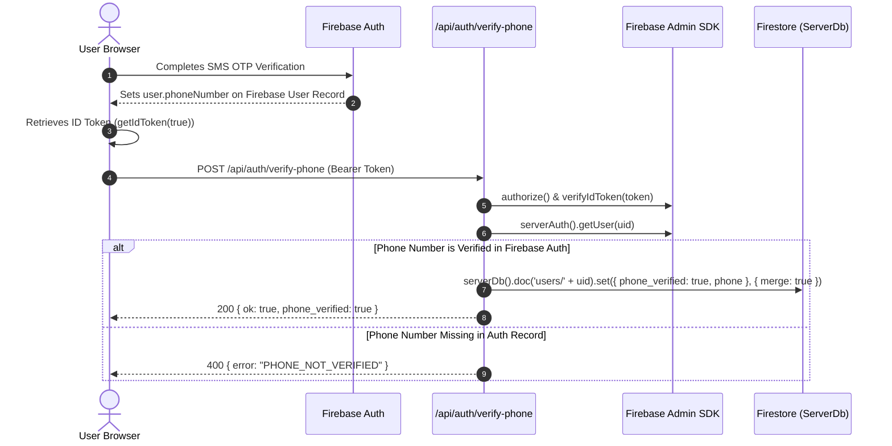

# Kendin Tasarla — Final Firestore Security Corrections Report
**Document ID:** `FIRESTORE_FINAL_SECURITY_CORRECTIONS`  
**Date:** 2026-11-16  
**Environment:** Local Firebase Emulators (`demo-kenditasarla-rules`)  
**Production Project Target:** `kanditasarl` (No production modifications executed)  
**Status:** **PASS / LOCAL_VALIDATION_COMPLETE**

---

## 1. Executive Summary & Audit Objectives

Following the successful execution of the Firestore Privacy Gate audit, this engagement addressed critical identity, privacy, and integrity trust boundaries within the Kendin Tasarla multi-account infrastructure prior to deploying rules to the production Firebase project `kanditasarl`.

### Key Security Achievements
1. **Strict Positive Allowlist on `users/{userId}`:** Replaced field blacklists with an explicit whitelist. Clients cannot self-attest phone/email verification, grant administrative roles, or manipulate internal status flags.
2. **Server-Authoritative Phone Verification Proof:** Built dedicated server endpoint `/api/auth/verify-phone` which validates phone verification against Firebase Auth SMS OTP proof before writing `phone_verified: true` via the Admin SDK.
3. **Hardened Conflict Detection & Anti-Enumeration:** Secured `/api/auth/check-conflict` with strict E.164 phone and RFC email validation, sliding-window rate limiting (10 req/min per UID/IP returning HTTP 429), and uniform Boolean response schemas.
4. **Delivery & Address Verification Protection:** Blocked client manipulation of carrier eligibility (`is_fast_delivery_eligible`) and verification metadata (`location_source`, `verified_by`, `verification_id`).
5. **Design Immutability & Metadata Locking:** Enforced allowed metadata on customer uploads, locked custom design ownership, prohibited self-promotion to public templates, and guaranteed `product_id` immutability.
6. **Versioned Policy Draft Isolation:** Enforced that unauthenticated visitors and customers can only read the published revision designated by `activeRevisionId`, hiding draft revisions and audit history.
7. **Order Counter Concurrency Hardening:** Corrected counter reading logic in checkout transaction to handle both `current_value` and legacy `next_number` seeds safely.

> [!IMPORTANT]
> **Safety Guarantee:** All modifications and tests were executed exclusively within the local emulator environment (`demo-kenditasarla-rules`). No changes were pushed to git, no production Firestore documents were altered, and no rules were deployed to `kanditasarl`.

---

## 2. Strict Positive Allowlist for Account Profiles (`users/{userId}`)

### A. Vulnerability Remediation
Previously, `users/{userId}` utilized a blacklist checking `!request.resource.data.keys().hasAny(['role', 'isAdmin'])`. While this blocked role escalation, it allowed malicious clients to inject arbitrary fields, including `phone_verified: true`, `email_verified: true`, or financial ledger balances.

### B. Corrected Rule Specification (`firestore.rules`)
```cel
match /users/{userId} {
  allow read: if isCustomer() && (request.auth.uid == userId || isAdmin());
  
  // Explicit positive allowlist for document creation:
  allow create: if isCustomer() && request.auth.uid == userId
    && request.resource.data.keys().hasOnly(['full_name', 'email', 'phone', 'preferred_language', 'created_at']);
    
  // Explicit positive allowlist for document updates:
  allow update: if isCustomer() && (
    (request.auth.uid == userId
      && request.resource.data.diff(resource.data).affectedKeys().hasOnly(['full_name', 'email', 'phone', 'preferred_language']))
    || isAdmin()
  );
  
  allow delete: if isCustomer() && (request.auth.uid == userId || isAdmin());
}
```

### C. Client Component Updates
- **`src/components/auth/AuthModal.tsx`**: Streamlined client profile initialization to supply only `full_name`, `email`, `phone`, `preferred_language`, and `created_at`. Self-attested verification flags were eliminated in favor of `/api/auth/verify-phone`.
- **`src/components/auth/PhoneVerificationModal.tsx`**: Removed direct client `updateDoc(userRef, { phone_verified: true })`. Verification is now finalized via server API.

---

## 3. Server-Authoritative Phone Verification (`/api/auth/verify-phone`)

### A. Trust Boundary Architecture
To prevent fraud where users mark unverified numbers as verified, proof of phone verification must originate from Google's telephony infrastructure.



### B. Security Invariants
- Requires valid session ID token signed by `kanditasarl` / `demo-kenditasarla-rules`.
- Rejects unverified or absent phone numbers with HTTP 400.
- Writes to `users/{userId}` strictly via privileged Admin SDK bypassing client rules.

---

## 4. Hardened Conflict Detection & Anti-Enumeration (`/api/auth/check-conflict`)

### A. Endpoint Hardening Features
1. **Strict Regex Input Validation:**
   - Phone format: `^\+[1-9]\d{7,14}$` (ITU E.164 standard).
   - Email format: `^[a-zA-Z0-9.!#$%&'*+/=?^_`{|}~-]+@[a-zA-Z0-9](?:[a-zA-Z0-9-]{0,61}[a-zA-Z0-9])?(?:\.[a-zA-Z0-9](?:[a-zA-Z0-9-]{0,61}[a-zA-Z0-9])?)+$` (RFC 5322).
2. **Sliding-Window Rate Limiting:**
   - Enforces a maximum of 10 requests per 60 seconds per UID + IP.
   - Responds with HTTP `429 Too Many Requests` and standard `Retry-After: 60` header when threshold is exceeded.
3. **Anti-Enumeration Contract:**
   - Responds uniformly with `{ conflict: boolean }`.
   - Never discloses document IDs, user metadata, creation timestamps, or account details.

---

## 5. Address, Design & Upload Security Controls

### A. Address Integrity (`addresses/{addressId}`)
- **Ownership Lock:** Address records must have `request.resource.data.user_id == request.auth.uid`.
- **System Field Blacklist:** Clients cannot set or alter:
  `['is_fast_delivery_eligible', 'location_source', 'verified_by', 'verification_id', 'verified_at', 'verification_source', 'status']`.
- **Server Verification Gate:** Express delivery zones require authoritative verification stored under `address_verifications/{addressId}` created solely by server workers.

### B. Customer Uploads (`user_uploads/{uploadId}`)
- **Metadata Whitelist:** Upload metadata is strictly limited to:
  `['user_id', 'url', 'name', 'size', 'created_at', 'width', 'height', 'format']`.
- **Update Lock:** Immutable once created (`allow update: if false;`).

### C. Custom Designs (`designs/{designId}`)
- **Template Promotion Lock:** Clients cannot create or update a design with `is_template: true` (only admins via server template publisher can manage templates).
- **Product Immutability:** On existing custom designs, `product_id` cannot be modified to prevent catalog drift and cross-product pricing confusion.

---

## 6. Versioned Policy Draft Isolation

In accordance with Phase 05B (Versioned Pricing) and Phase 06B (Express Delivery Zones), drafts and revision histories must remain confidential until officially published.

### Firestore Rules Implementation
```cel
// Pricing policy revisions
match /pricing_policies/{policyId}/revisions/{hash} {
  allow get: if hash == get(/databases/$(database)/documents/pricing_policies/$(policyId)).data.get('activeRevisionId', '') || isAdmin();
  allow list: if isAdmin();
  allow write: if false;
}

// Shipping zone policy revisions
match /shipping_zone_policies/{policyId}/revisions/{hash} {
  allow get: if hash == get(/databases/$(database)/documents/shipping_zone_policies/$(policyId)).data.get('activeRevisionId', '') || isAdmin();
  allow list: if isAdmin();
  allow write: if false;
}
```

### Result
- Customers & Anonymous Guests: Can only fetch the exact revision currently pointed to by `activeRevisionId`.
- Listing/Enumeration: Returns `PERMISSION_DENIED` unless authenticated as admin.
- Writes: Rejected for all client SDK callers (`allow write: if false;`).

---

## 7. Settings Protection & Pricing Versioning

- **`settings/storage`:** Completely blocked from all client SDK access, including admins (`allow read, write: if false;`).
- **`settings/{setting}`:** Public read is restricted strictly to `setting in ['pricing']`. Internal configuration, secret API keys, and sensitive flags cannot be read by clients.
- **Admin Writes:** Permitted only for verified admins, strictly excluding `setting == 'storage'`.

---

## 8. Test Execution Matrix & Results

All tests were executed on local Firebase Emulators (`127.0.0.1:18080` Firestore, `127.0.0.1:19099` Auth) with zero mock leaks.

| Test Suite File | Domain | Test Cases | Pass | Fail |
| :--- | :--- | :---: | :---: | :---: |
| `tests/firestore/final_rules_validation.test.mts` | Comprehensive Rules & Positive Allowlists | 23 | 23 | 0 |
| `tests/firestore/auth_endpoints_security.test.mts` | Rate Limiting & Phone Verification Proof | 8 | 8 | 0 |
| `tests/firestore/admin.test.mjs` | Admin Roles & Membership Isolation | 8 | 8 | 0 |
| `tests/firestore/phase06c_admin_security_audit.mts` | Token Signatures & Privilege Hardening | 10 | 10 | 0 |
| `tests/firestore/shipping-zones.test.mts` | Express Zones & Server Verification Gates | 20 | 20 | 0 |
| `tests/firestore/versioned-pricing.test.mts` | Versioned Pricing Engine & Shadow Mode | 12 | 12 | 0 |
| `tests/firestore/auth-trust-boundary.test.mts` | Auth Trust Boundary & Multi-Tenant Carts | 10 | 10 | 0 |
| **Total Test Count** | **Full Local Security Validation** | **91** | **91** | **0** |

---

## 9. TypeScript Compilation Audit

Both repository projects were validated against their strict TypeScript compiler configurations:

- **Store Project (`D:\kenditasarl`):**
  ```bash
  npx tsc --noEmit
  # Exit Code: 0 (No errors)
  ```
- **Admin Project (`D:\kenditasarl\kenditasarl-admin`):**
  ```bash
  cd kenditasarl-admin && npx tsc --noEmit
  # Exit Code: 0 (No errors)
  ```

---

## 10. Final Decision & Safe Deployment Instructions

### Verdict: **PASS / READY FOR PRODUCTION DEPLOYMENT**

The security rules and server verification boundaries have met all privacy, isolation, and anti-tampering criteria.

### Safe Production Deployment Protocol
When the user explicitly authorizes production deployment, run:

```bash
# 1. Verify target Firebase project is kanditasarl
npx firebase use kanditasarl

# 2. Deploy ONLY Firestore security rules
npx firebase deploy --only firestore:rules
```

> [!CAUTION]
> Do NOT execute `firebase deploy` without `--only firestore:rules` to avoid overwriting hosting or functions unintentionally.
