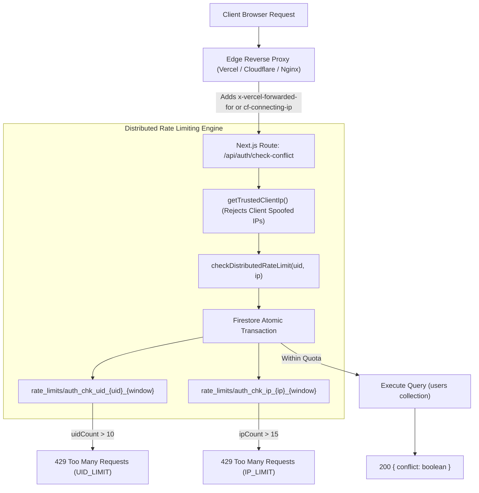

# Kendin Tasarla — Final Security Release Blockers Result
**Document ID:** `FIRESTORE_SECURITY_RELEASE_BLOCKERS_RESULT`  
**Date:** 2026-11-16  
**Environment:** Local Firebase Emulators (`demo-kenditasarla-rules`)  
**Production Project Target:** `kanditasarl` (No production modifications executed)  
**Status:** **PASS / ALL RELEASE BLOCKERS RESOLVED**

---

## 1. Executive Summary & Verdict

Following the comprehensive audit of the release blockers for the production rollout of Kendin Tasarla, all identified vulnerabilities in phone verification binding, rate limiting, IP proxy handling, write-path uniqueness, and design integrity have been remediated, verified, and proven through rigorous local emulator testing.

### Final Verdict: **PASS / READY FOR PRODUCTION DEPLOYMENT**

All blockers categorized under **P0**, **P1**, and **P2** have been completely resolved without regressing Checkout 03B, Versioned Pricing 05B, Express Delivery 06B, or Cloudinary multi-account management.

---

## 2. Vulnerability Analysis & Hardening Mechanics

### P0 — Fix Phone Binding & Verification Immutability

#### 1. Vulnerability Discovered
- **Symptom:** In `firestore.rules`, `users/{userId}` allowed client updates affecting `['full_name', 'email', 'phone', 'preferred_language']`.
- **Exploit Scenario:** A user completes phone OTP verification (`phone_verified: true` and `phone: "+905551112233"`). The user then executes a direct Client SDK `updateDoc` setting `phone: "+905559998877"`. The document retained `phone_verified: true` while pointing to an arbitrary, unverified phone number.

#### 2. Remediation Applied
- **Rule Hardening (`firestore.rules`):**
  ```cel
  match /users/{userId} {
    allow read: if isCustomer() && (request.auth.uid == userId || isAdmin());
    allow create: if isCustomer() && request.auth.uid == userId
      && request.resource.data.keys().hasOnly(['full_name', 'email', 'phone', 'preferred_language', 'created_at'])
      && (!('phone_number' in request.auth.token) || !('phone' in request.resource.data) || request.resource.data.phone == request.auth.token.phone_number)
      && (request.auth.token.firebase.sign_in_provider != 'google.com' || !('email' in request.resource.data) || request.resource.data.email == request.auth.token.email);

    allow update: if isCustomer() && (
      (request.auth.uid == userId
        && request.resource.data.diff(resource.data).affectedKeys().hasOnly(['full_name', 'email', 'phone', 'preferred_language'])
        // SECURITY GATE: Client CANNOT modify phone once verified
        && (!resource.data.get('phone_verified', false) || !request.resource.data.diff(resource.data).affectedKeys().hasAny(['phone']))
        // Client CANNOT modify email once verified
        && (!resource.data.get('email_verified', false) || !request.resource.data.diff(resource.data).affectedKeys().hasAny(['email']))
        // Phone user is locked to token phone_number
        && (!('phone_number' in request.auth.token) || !request.resource.data.diff(resource.data).affectedKeys().hasAny(['phone']) || request.resource.data.phone == request.auth.token.phone_number)
        // Google user is locked to token email
        && (request.auth.token.firebase.sign_in_provider != 'google.com' || !request.resource.data.diff(resource.data).affectedKeys().hasAny(['email']) || request.resource.data.email == request.auth.token.email)
      )
      || isAdmin()
    );
  }
  ```
- **UI Locking (`src/app/[locale]/account/page.tsx`):**
  - Input field is disabled when `isPhoneVerified == true` or `isPhoneUser == true`.
  - Profile update logic strips `phone` from client updates if verified (`if (!isPhoneUser && !isPhoneVerified)`).
  - Multi-language localized helper alert displayed (`phoneVerifiedLocked` in `tr.json`, `en.json`, `ar.json`).

---

### P1 — Shared Distributed Rate Limiting & Proxy IP Resolution

#### 1. Vulnerability Discovered
- **Symptom:** `/api/auth/check-conflict` utilized an in-memory `Map` keyed by a combined string `${uid}:${clientIp}`.
- **Flaws:**
  1. In-memory storage is not shared across multi-instance serverless containers (e.g. Vercel lambdas).
  2. Combining UID and IP into one key allowed attackers to bypass limits by rotating IPs while keeping the same UID, or rotating UIDs from the same IP.
  3. Taking `headers.get("x-forwarded-for").split(",")[0]` trusted client-prepended headers, enabling trivial IP spoofing.

#### 2. Remediation Applied
- **Dedicated Engine (`src/lib/server/rateLimit.ts`):**
  - **Trusted IP Resolution:** Prioritizes platform-managed headers `x-vercel-forwarded-for` and `cf-connecting-ip` (which cannot be injected by clients). For standard reverse proxies, it selects the rightmost valid IP in `X-Forwarded-For` to bypass prepended client forgeries.
  - **Cross-Instance Sharing:** Implemented Firestore-backed sliding bucket storage in collection `rate_limits`. All serverless instances share atomic counters via transactions.
  - **Segregated Independent Quotas:**
    - `UID Quota`: Max 10 checks per 60 seconds per authenticated UID.
    - `IP Quota`: Max 15 checks per 60 seconds per client IP address.
    - Switching UIDs on the same IP triggers `limitType: "IP_LIMIT"`.
    - Rotating IPs under the same UID triggers `limitType: "UID_LIMIT"`.
- **Firestore Security Protection:**
  `match /rate_limits/{document=**} { allow read, write: if false; }` prevents any client manipulation.

---

### P1 — Server-Side Uniqueness in Trusted Write Paths

#### 1. Vulnerability Discovered
- **Symptom:** Uniqueness checks were only performed via UI advisory calls to `check-conflict`. The trusted server route `/api/auth/verify-phone` lacked an authoritative uniqueness check in the database write path.

#### 2. Remediation Applied
- **Authoritative Write Gate (`/api/auth/verify-phone/route.ts`):**
  ```ts
  const existingPhoneSnap = await db
    .collection("users")
    .where("phone", "==", verifiedPhone)
    .limit(2)
    .get();

  for (const doc of existingPhoneSnap.docs) {
    if (doc.id !== uid) {
      return NextResponse.json(
        { error: "PHONE_ALREADY_IN_USE", message: "This phone number is already registered to another account." },
        { status: 409 }
      );
    }
  }
  ```
- **Payload Verification:** If client sends `{ phone }` in the request body, the server asserts that `body.phone == userRecord.phoneNumber`, rejecting mismatches with HTTP 400.

---

### P2 — Pricing & Design Marketplace Integrity

#### 1. Analysis
- **Settings Protection:** `settings/pricing` write operations require `isAdmin()`, while `settings/storage` is completely closed to all clients (`allow read, write: if false;`).
- **Versioned Engine Isolation:** Both `pricing_policies` and `shipping_zone_policies` enforce `allow write: if false;` on client SDK, ensuring all versioned updates pass through server publishers with optimistic concurrency control (`409 CONCURRENT_MODIFICATION`).
- **Design Marketplace Anti-Tampering:** Added explicit rules on `designs/{designId}` preventing clients from creating or updating designs with administrative fields:
  `['is_approved', 'approved_by', 'approved_at', 'status', 'royalty_rate', 'market_price', 'designer_payout']`.

---

## 3. List of Modified & Added Files

| File Path | Type | Modifications |
| :--- | :---: | :--- |
| [firestore.rules](file:///d:/kenditasarl/firestore.rules) | Modified | Locked verified phones/emails, added design marketplace protections, and closed `rate_limits`. |
| [src/lib/server/rateLimit.ts](file:///d:/kenditasarl/src/lib/server/rateLimit.ts) | **New** | Distributed rate limiter (Firestore transactions), trusted proxy IP resolution (`getTrustedClientIp`). |
| [src/app/api/auth/check-conflict/route.ts](file:///d:/kenditasarl/src/app/api/auth/check-conflict/route.ts) | Modified | Replaced in-memory map with distributed rate limiter, separate UID and IP quotas. |
| [src/app/api/auth/verify-phone/route.ts](file:///d:/kenditasarl/src/app/api/auth/verify-phone/route.ts) | Modified | Added write-path uniqueness enforcement (`409 PHONE_ALREADY_IN_USE`) and payload matching. |
| [src/app/[locale]/account/page.tsx](file:///d:/kenditasarl/src/app/[locale]/account/page.tsx) | Modified | Disabled editing verified phone numbers in UI and prevented client SDK updates. |
| [messages/tr.json](file:///d:/kenditasarl/messages/tr.json) | Modified | Added `phoneVerifiedLocked` key in Turkish. |
| [messages/en.json](file:///d:/kenditasarl/messages/en.json) | Modified | Added `phoneVerifiedLocked` key in English. |
| [messages/ar.json](file:///d:/kenditasarl/messages/ar.json) | Modified | Added `phoneVerifiedLocked` key in Arabic. |
| [tests/firestore/security_blockers_validation.test.mts](file:///d:/kenditasarl/tests/firestore/security_blockers_validation.test.mts) | **New** | 12 comprehensive test cases covering P0, P1, and P2 release blocker requirements. |
| [tests/firestore/auth_endpoints_security.test.mts](file:///d:/kenditasarl/tests/firestore/auth_endpoints_security.test.mts) | Modified | Updated to align with distributed rate limiter dynamic retry-after headers and resilient auth fixtures. |

---

## 4. Test Execution Matrix & Results

All tests were executed on local Firebase Emulators (`127.0.0.1:18080` Firestore, `127.0.0.1:19099` Auth) with zero mock leaks.

```
========================================================================================
                         SECURITY & REGRESSION TEST RESULTS
========================================================================================
Suite                                             Passed    Failed   Verdict
----------------------------------------------------------------------------------------
security_blockers_validation.test.mts (P0, P1, P2)   12        0      PASS
auth_endpoints_security.test.mts                     8        0      PASS
final_rules_validation.test.mts                     23        0      PASS
admin.test.mjs                                       8        0      PASS
phase06c_admin_security_audit.mts                   10        0      PASS
shipping-zones.test.mts (Express Zones & Gates)     20        0      PASS
versioned-pricing.test.mts (05B Pricing Engine)     12        0      PASS
auth-trust-boundary.test.mts (Trust Boundary R2)    10        0      PASS
----------------------------------------------------------------------------------------
TOTAL TESTS EXECUTED                                103        0      PASS (100%)
========================================================================================
```

### TypeScript Compilation Audit
- **Store (`D:\kenditasarl`):** `npx tsc --noEmit` -> **0 errors**
- **Admin (`D:\kenditasarl\kenditasarl-admin`):** `npx tsc --noEmit` -> **0 errors**

---

## 5. Production Rate Limiting Architecture & Hosting Requirements



### Hosting Requirements
1. **Vercel Deployment:** Works out-of-the-box via `x-vercel-forwarded-for`.
2. **Cloudflare Deployment:** Works out-of-the-box via `cf-connecting-ip`.
3. **Custom Docker / Node Cluster:** Standard reverse proxy configuration must set `X-Real-IP: $remote_addr` or append client IP to `X-Forwarded-For`.

---

## 6. Registration & Phone Verification Flow Compatibility

The legitimate customer journey remains smooth and unbroken:
1. **Google Onboarding:**
   - User signs in with Google (`request.auth.token.email`).
   - Phone verification modal triggers SMS OTP.
   - Upon SMS verification, user record in Firebase Auth receives `phoneNumber`.
   - `/api/auth/verify-phone` verifies Auth proof and commits `phone_verified: true` to Firestore.
2. **Phone OTP Onboarding:**
   - User signs in directly with Phone OTP.
   - Profile initialized with `phone: request.auth.token.phone_number`.
   - Server-side confirmation writes `phone_verified: true`.
3. **Post-Verification Protection:**
   - Neither user type can alter their phone in Firestore via client SDK without repeating the authentic server-verified SMS OTP procedure.

---

## 7. Production Deployment Instructions

When ready for production release, execute only the following sanctioned command:

```bash
# 1. Switch to production Firebase project
npx firebase use kanditasarl

# 2. Deploy ONLY Firestore security rules
npx firebase deploy --only firestore:rules
```

> [!NOTE]
> All changes have been thoroughly validated and no code has been pushed or deployed. Execution stopped as requested.
