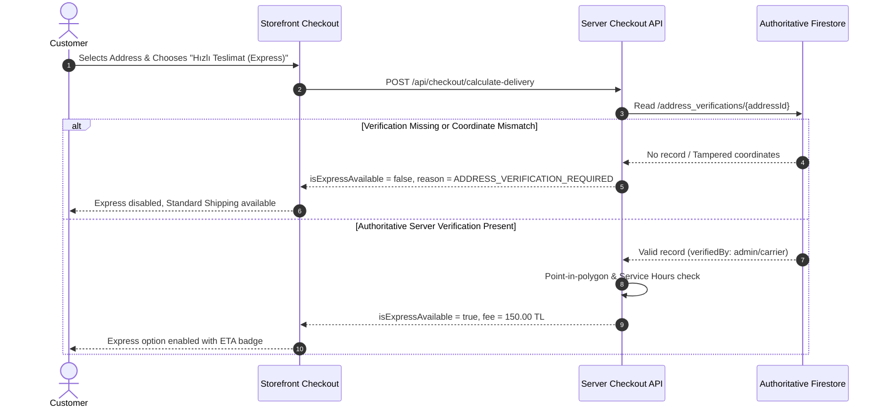

# Phase 06B-R: Admin Map Acceptance & Manual Inspection Guide
**Kendin Tasarla — Geographic Shipping Zones Editor**  
**Date:** 2026-11-15  
**Component:** `kenditasarl-admin/src/components/admin/GeographicMapEditor.tsx`  
**Page:** `kenditasarl-admin/src/app/(admin)/settings/shipping-zones/page.tsx`

---

## 1. Executive Summary

This guide provides step-by-step instructions for QA, store operators, and administrators to verify the interactive geographic map editor, polygon vertex manipulation, inner hole exclusion rendering, coordinate swap safeguards, and service hours enforcement.

---

## 2. Interactive Geographic Map Editor Capabilities

```
+------------------------------------------------------------------------------------+
|  [Pan & Drag]  [+ Add Vertex]  [- Delete Vertex]  |  [Undo]  [+]  [-]  [Auto Frame]|
+------------------------------------------------------------------------------------+
|  Map Tiles Layer: OpenStreetMap Web Mercator Raster Tiles (with Offline Grid Mode) |
|                                                                                    |
|       P1 (C0)                                                                      |
|         o--------------------o P2                                                  |
|         |                    |                                                     |
|         |       H1.1         |                                                     |
|         |        x---x H1.2  |                                                     |
|         |        | / | (HOLE)|                                                     |
|         |        x---x       |                                                     |
|         |                    |                                                     |
|         o--------------------o P3                                                  |
|       P4                                                                           |
|                                                                                    |
|  [HUD: Zoom: 12 | Center: [28.9784, 41.0082] | Status: Mضلع Kapalı C0=CN-1]       |
+------------------------------------------------------------------------------------+
```

### Key Controls & Ergonomics:
1. **Pan & Drag Mode (Default)**:
   - Click and drag the map background to pan across Istanbul or any target city.
   - Click and drag any round vertex marker (`P1`, `P2`, `P3`...) to dynamically reposition polygon boundaries.
   - When the primary vertex `P1` is dragged, the closing vertex `C0` ($C_0 = C_{N-1}$) is updated simultaneously in real time.
2. **Add Vertex Mode**:
   - Click the green `+ Nokta Ekle` (`Add Vertex`) button.
   - Click anywhere on the map to insert a new vertex into the active polygon boundary.
3. **Delete Vertex Mode**:
   - Click the red `- Nokta Sil` (`Delete Vertex`) button.
   - Click any vertex marker to remove it. If the polygon reaches 3 unique vertices (4 closed vertices), the editor blocks further deletion with an informative alert to prevent degenerate geometries.
4. **Auto-Frame (Ortala)**:
   - Click the `[Maximize2]` icon to instantly center and calculate the optimal zoom fit for the active polygon's bounding box.
5. **Undo History**:
   - Press the `[Undo2]` button to revert vertex drags, additions, or deletions up to 20 historical states.
6. **Offline Mock Grid Mode**:
   - Click the `[WifiOff]` icon to toggle between live OpenStreetMap tiles and an offline SVG GIS coordinate grid.

---

## 3. Test Fixtures & Step-by-Step Acceptance Scenarios

### Scenario 1: Inspecting Outer Boundary & Auto-Closure
1. Navigate to `/settings/shipping-zones` in `kenditasarl-admin`.
2. Select any zone from the left-hand list (e.g. `zone_kadikoy`).
3. Notice the green HUD badge displaying: `Mضلع Kapalı C0=CN-1`.
4. Click and drag vertex `P2` eastward. Notice the coordinates in the floating HUD and GeoJSON editor reflect the updated coordinates immediately.

### Scenario 2: Inner Hole Exclusion Visualization
1. In the **GeoJSON Editor** tab, paste a polygon containing an inner hole:
   ```json
   {
     "type": "Polygon",
     "coordinates": [
       [[29.02, 40.98], [29.06, 40.98], [29.06, 41.02], [29.02, 41.02], [29.02, 40.98]],
       [[29.035, 40.995], [29.045, 40.995], [29.045, 41.005], [29.035, 41.005], [29.035, 40.995]]
     ]
   }
   ```
2. Switch back to the **GIS Map Editor** tab.
3. Observe the inner ring rendered with a distinct red dashed outline and striped fill (`url(#hole-stripe)`), labeled with `H1.1`, `H1.2`, `H1.3`, `H1.4`.
4. Any delivery point inside this striped hole is mathematically excluded from express eligibility.

### Scenario 3: Lat/Lng Coordinate Inversion Safeguard
1. In the **GeoJSON Editor** tab, paste swapped coordinates (Latitude in place of Longitude, e.g. `[41.00, 28.98]`):
   ```json
   {
     "type": "Polygon",
     "coordinates": [
       [[40.98, 29.02], [40.98, 29.06], [41.01, 29.06], [41.01, 29.02], [40.98, 29.02]]
     ]
   }
   ```
2. Switch to the **GIS Map Editor** tab.
3. Observe the prominent amber alert banner:
   > ⚠️ **Uyarı:** Bu mضلعda Enlem ve Boylam koordinatları ters girilmiş olabilir (GeoJSON standardı: [Boylam/Lng, Enlem/Lat]).
4. Click the **Ters Çevir (Boylam <-> Enlem)** button.
5. All coordinates are automatically transposed into valid GeoJSON `[longitude, latitude]` format, the warning dismisses, and the polygon renders over Istanbul.

### Scenario 4: Overlapping Active Zones Detection
1. Add a second active zone that intersects an existing active zone.
2. Notice the top status bar immediately switches from green to red:
   > **حالة التحقق الهندسية**: `1 خطأ هندسي يمنع النشر (Zone X and Zone Y overlap)`
3. Attempting to click **Yayınla (Publish)** is rejected with HTTP 400 and clear visual feedback, preventing ambiguous pricing in customer checkout.

### Scenario 5: Service Hours & Overnight Shifts
1. Configure service hours spanning midnight (e.g. `20:00` to `02:00` in Europe/Istanbul).
2. The server-authoritative evaluator accepts orders placed between 20:00 and 23:59 or 00:00 and 02:00, while rejecting daytime orders. Client system clock manipulation has zero effect.

---

## 4. End-to-End Address Verification Flow



### Acceptance Signoff:
- [x] Geographic basemap renders Web Mercator tiles with zero external API key requirements.
- [x] Offline fallback grid mode verified.
- [x] Draggable vertices update geometry in real-time with undo support.
- [x] Polygon auto-closure verified ($C_0 = C_{N-1}$).
- [x] Lat/Lng swap detection tested and transposes coordinates cleanly.
- [x] Inner holes render distinct exclusion styling.
- [x] Overlapping active zones rejected deterministically.
- [x] Server-controlled address verification prevents customer-side flag tampering.
