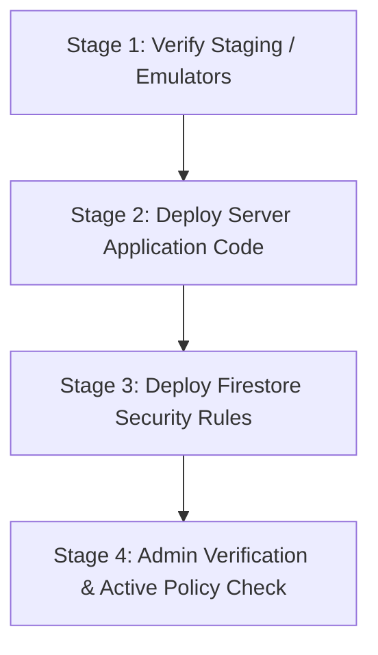

# Phase 06B-R: Safe Release & Non-Destructive Recovery Plan (v2)
**Kendin Tasarla — Express Delivery Zones System**  
**Version:** `2.0.0` (Supersedes v1.0.0)  
**Date:** 2026-11-15  
**Current Gate:** `LOCAL PHASE 06B-R: PASS` | `LIVE DEPLOYMENT: BLOCKED`

---

## 1. Architectural Principles & Non-Destructive Recovery

### 1.1 Non-Destructive Recovery Philosophy
In Version 1 of the release plan, a hazardous command was suggested:
```powershell
# DANGEROUS / FORBIDDEN IN V2:
Expand-Archive -Path '.../checkpoint.zip' -DestinationPath 'D:\kenditasarl' -Force
```
This destructive in-place extraction risks silently overwriting uncommitted work, untracked fixtures, or git state. **In v2, in-place overwrites are strictly banned.**

### 1.2 Approved Staging & Selective Recovery Procedure
When recovery from an archive is required:
1. **Isolated Extraction**: Always extract the checkpoint into an isolated recovery scratch tree:
   ```powershell
   $RecoveryStaging = "C:\Users\KADLO-X0X\.gemini\antigravity\brain\f61f5472-3080-4e52-9d4d-a10bd6954062\scratch\recovery_staging_$(Get-Date -Format 'yyyyMMdd_HHmmss')"
   New-Item -ItemType Directory -Path $RecoveryStaging -Force
   Expand-Archive -Path "C:\Users\KADLO-X0X\.gemini\antigravity\brain\f61f5472-3080-4e52-9d4d-a10bd6954062\scratch\checkpoint_phase06b_r\kenditasarla_phase06b_r_checkpoint.zip" -DestinationPath $RecoveryStaging
   ```
2. **Side-by-Side Diffing**: Compare the staging directory against the working repository before copying anything:
   ```powershell
   Compare-Object -ReferenceObject (Get-ChildItem -Recurse -File $RecoveryStaging) -DifferenceObject (Get-ChildItem -Recurse -File D:\kenditasarl)
   ```
3. **Selective Review & Restoration**: Copy only the specific affected files after manual inspection, preserving current working tree changes.
4. **Git Protection**: Never invoke `git reset --hard` or `git clean -fd`. Keep all tracked and untracked work intact.

---

## 2. Checkpoint Provenance & Audit Trail

| Checkpoint Name | Location | SHA-256 Checksum | Scope & Inventory |
|---|---|---|---|
| **Pre-06B Baseline** | `scratch/checkpoint_phase06b/kenditasarla_full_checkpoint.zip` | `27E8040EA2D124BA9A874F7A3E21D37BE8D1A008CE9DAAE760C16B302DF2C694` | Pre-06B baseline (Phase 01–06A-R2) |
| **Post-06B-R Gate** | `scratch/checkpoint_phase06b_r/kenditasarla_phase06b_r_checkpoint.zip` | `9D1FCE30B237DB0D88C4310FB22BB3053C00F08FE5ECC0992F5363F5B8AE46BA` | 442 files: GeographicMapEditor, server address verification, 20/20 test suite, verified extraction |

---

## 3. Coordinated Production Cutover Order

Deploying stricter Firestore rules **before** application servers are updated will immediately break customer checkout. The release must follow a strictly coordinated 4-stage rollout:



### Stage 1: Emulator & Staging Gate (Zero Risk)
- Execute all 8 test suites on local emulators (`npm run test:zones`, `test:gate`, `test:r2`, `test:matching`, `test:pricing`, `test:checkout`, `test:template`, `test:cloudinary`, `test`).
- Verify both Next.js production builds compile with zero errors.

### Stage 2: Server Application Code Cutover
- Deploy updated Store and Admin server backends.
- Old clients requesting standard delivery will continue using standard shipping without disruption.
- Old clients requesting express will fail closed safely if unverified, without crashing the server.

### Stage 3: Firestore Security Rules Deployment
- Deploy `firestore.rules` containing `/address_verifications` server-only restriction (`allow read, write: if false;`) and `/shipping_zone_policies` immutability rules.
- Because Stage 2 is already live, server Admin SDK calls to `address_verifications` bypass client rules seamlessly.

### Stage 4: Admin Activation & Post-Launch Smoke Test
- Provisioned admin logs into Admin panel (`/settings/shipping-zones`).
- Publish initial reviewed operational zones.
- Run smoke test: Standard shipping checkout confirms; Express checkout confirms only with authoritative server verification.

---

## 4. Realistic Downtime & Observability (Correcting Claims)

> [!WARNING]
> Prior documentation claimed guaranteed *"0 seconds downtime"*. This is technically inaccurate for stateful distributed Firestore transactions.
> Real-world cutover metrics:
> - **Zero-downtime standard delivery**: Standard shipping checkout has zero schema downtime because it does not depend on express policy pointer documents.
> - **Express cutover window**: During rule deployment propagation (typically 2 to 15 seconds across Google Cloud edges), any in-flight client write attempting direct modification of `/shipping_zone_policies` will be rejected by security rules. Server transactions automatically retry up to 5 times.
> - **Observable Health Checks**: Monitor `/api/checkout/calculate-delivery` response codes and Firestore transaction contention metrics.

---

## 5. Emergency Deactivation Procedure (Kill-Switch)

If an issue occurs with express couriers, extreme weather, or incorrect zone boundaries:
1. **Safe Kill-Switch**: The administrator opens `kenditasarl-admin/src/app/(admin)/settings/shipping-zones` and toggles zones to `isActive: false`, or updates the active policy to an empty zone set and clicks **Publish**.
2. **Zero Blast Radius**:
   - Standard shipping remains 100% operational.
   - Any new customer selecting express receives a clear localized explanation (`Hızlı teslimat şu anda aktif değildir`).
   - Confirmed orders retain their immutable `shipping_snapshot` with the historical fee and zone details for audit compliance.

---

## 6. Live Launch Blockers (Mandatory Production Gate)

The system remains strictly `LIVE DEPLOYMENT: BLOCKED` until the business owner signs off on:
1. **Cloudinary Production Rotation**: Rotate all demo/development API secrets and configure production webhooks.
2. **Authorized Admin UID Provisioning**: Seed actual authorized business administrator UIDs into `/admins/{uid}` on production Firestore.
3. **Physical Garment & Courier SLA Signoff**: Validate physical print alignment on garments and establish operational contracts with courier dispatchers in Istanbul.
4. **Live Geocoding Service Integration**: Configure production Google Places / Carrier Geocoding server credentials for automated address verification.
