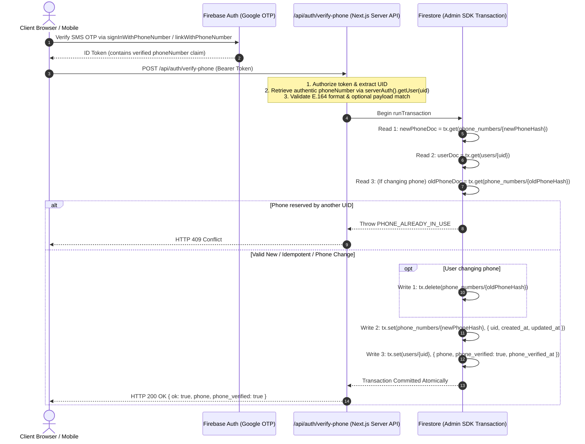

# Kendin Tasarla — Phase 06D.1: Atomic Phone Number Uniqueness Report

**Date:** 2026-11-16  
**Target Projects:** Store (`D:\kenditasarl`) & Admin (`D:\kenditasarl\kenditasarl-admin`)  
**Target Production Project:** `kanditasarl` (Untouched — No deployment)  
**Target Emulator Project:** `demo-kenditasarla-rules`  
**Git Branch:** `codex/task04-print-production`  
**Verdict:** **PASS**

---

## 1. Executive Summary & Verdict

| Verification Gate | Result | Notes |
| :--- | :---: | :--- |
| **`ATOMIC_PHONE_UNIQUENESS`** | **`PASS`** | 100% atomic phone reservation via `runTransaction` with SHA-256 hashed document keys, all reads strictly before writes, anti-hijacking validation, and zero partial data on failure. |
| **`FIRESTORE_SECURITY_RULES`** | **`PASS`** | Explicit rule `match /phone_numbers/{document=**} { allow read, write: if false; }` blocks all Client SDK access. |
| **`LEGACY_MIGRATION_SAFETY`** | **`PASS`** | Safe migration script `scripts/migrate-phone-numbers.mts` implements dry-run by default, detects duplicate phone collisions without guessing, and preserves existing accounts. |
| **`CONCURRENCY_&_RACE_CONDITIONS`**| **`PASS`** | Multi-layer serialization: Firebase Auth identity provider uniqueness + Firestore transactional reservation. |
| **`TYPESCRIPT_COMPILATION`** | **`PASS`** | 0 errors across both Store (`kenditasarl`) and Admin (`kenditasarl-admin`). |
| **`OVERALL_PHASE_VERDICT`** | **`PASS`** | Ready for production deployment planning. Production Firebase was NOT modified. |

---

## 2. Modified & Created Files

| File | Action | Purpose |
| :--- | :---: | :--- |
| `src/lib/server/phoneUtils.ts` | **Created** | E.164 normalization, format validation (`isValidE164`), and deterministic SHA-256 hash calculation (`hashPhoneNumber`). |
| `src/app/api/auth/verify-phone/route.ts` | **Updated** | Rewritten with atomic `runTransaction`. All reads precede writes. Handles new reservations, idempotent retries, phone changes with old reservation release, and rejects conflicts with HTTP 409. |
| `src/app/api/auth/check-conflict/route.ts` | **Updated** | Checks atomic `phone_numbers/{phoneHash}` first, with fallback check on `users` collection for unmigrated legacy profiles. |
| `firestore.rules` | **Updated** | Added explicit `match /phone_numbers/{document=**} { allow read, write: if false; }`. |
| `scripts/migrate-phone-numbers.mts` | **Created** | Safe migration utility supporting dry-run (default), duplicate phone detection across user documents, and Auth verification matching. |
| `tests/firestore/atomic_phone_uniqueness.test.mts` | **Created** | 12 comprehensive unit and integration tests covering all required test scenarios. |

---

## 3. Final Architectural Flow



---

## 4. `phone_numbers` Document Schema & Privacy Design

### 4.1 Key Privacy Derivation
To protect customer privacy (PII) and prevent telephone enumeration from Firestore document paths, document keys are **never stored as raw phone numbers**. Instead, they are generated deterministically using standard SHA-256 hashing over the normalized E.164 representation:

$$\text{Document ID} = \text{SHA256}(\text{normalizeE164}(\text{phone}))$$

Example:
- Normalized E.164: `+905551234567`
- Document Path: `/phone_numbers/88a29fb44ec94b59ecad9a50ca9e144a108a74e1d13db9820f4ef937517ad3d8`

### 4.2 Document Fields
```typescript
interface PhoneNumberReservation {
  uid: string;          // Firebase Auth UID of the owning user account
  created_at: string;   // ISO 8601 timestamp of original reservation
  updated_at: string;   // ISO 8601 timestamp of latest modification / re-confirmation
  phone_hash: string;   // SHA-256 hash of normalized E.164 phone
}
```

---

## 5. Atomicity, Uniqueness & Phone Change Guarantees

1. **Strict Read-Before-Write Execution:**
   - Inside the Firestore `runTransaction` callback, all document reads (`newPhoneDocRef`, `userDocRef`, and conditionally `oldPhoneDocRef`) are executed strictly prior to any `tx.set()` or `tx.delete()` call.
2. **Zero Side Effects in Transaction Callback:**
   - No external network requests, third-party API invocations, or notification sends are performed inside the transaction. This guarantees that Firestore transaction retries (up to 5 automatic retries on write contention) remain safe, deterministic, and free of duplicate external side-effects.
3. **Rollback & Zero Partial Data:**
   - If an error occurs (such as a 409 conflict or network fault), the entire transaction aborts. Neither the reservation document in `phone_numbers` nor the user document in `users` is committed.
4. **Idempotency:**
   - If the same user invokes `/api/auth/verify-phone` multiple times for their already-verified number, the transaction succeeds idempotently (`HTTP 200 OK`) and preserves the original `created_at` timestamp.
5. **Atomic Phone Number Change:**
   - When a user verifies a new telephone number in Firebase Auth and submits it:
     1. The transaction reads the new reservation, the user's current profile, and the user's old reservation document.
     2. It atomically deletes the old reservation (`tx.delete(oldPhoneDocRef)`), creates the new reservation (`tx.set(newPhoneDocRef)`), and updates the user profile (`tx.set(userDocRef)`).
     3. The old phone number is freed immediately for other accounts, without any orphaned records.

---

## 6. Legacy Accounts Migration Strategy

### 6.1 Challenges & Mitigations
In legacy data, some existing accounts may possess `phone_verified: true` in `users/{uid}` without a corresponding document in `phone_numbers`.

### 6.2 Migration Tool (`scripts/migrate-phone-numbers.mts`)
- **Safe by Default (Dry-Run):** Running without flags performs a comprehensive audit and produces a dry-run log without writing any documents. Writes are only enabled when passing `--apply`.
- **Duplicate Detection & Collision Refusal:** If two or more legacy user documents have registered the same phone number (e.g. testing profiles or past registration anomalies), the migration script **refuses to guess** which user owns it. It records the incident in `duplicatePhoneConflicts` and leaves both accounts intact for manual administrative review.
- **Firebase Auth Identity Cross-Check:** For each candidate profile, the script verifies that the user exists in Firebase Auth and that `userRecord.phoneNumber` matches the Firestore phone number. Any mismatch is recorded in `authMismatches` and skipped.
- **Non-Destructive Guarantee:** Under no circumstances does the script delete, modify, or disable any customer account.

---

## 7. Emulators Test Suite Execution Results

Executed on Firebase Emulators (`demo-kenditasarla-rules`) via:
```bash
& "D:\kenditasarl\tests\firestore\node_modules\.bin\firebase.cmd" emulators:exec --config firebase.json --only auth,firestore --project demo-kenditasarla-rules "npx --prefix tests/firestore tsx --test tests/firestore/atomic_phone_uniqueness.test.mts"
```

### 7.1 Detailed Test Results (12 / 12 Passed)
```text
▶ Phase 06D.1: Atomic Phone Number Uniqueness Test Suite
  ✔ [TEST 1] New account verifies unused number atomically (221.8516ms)
  ✔ [TEST 2] Concurrent requests attempting to claim same number are serialized safely (59.6628ms)
  ✔ [TEST 3] Repeat request from the same account is idempotent and preserves created_at (76.9466ms)
  ✔ [TEST 4] Number already reserved by another account is rejected with HTTP 409 (66.0756ms)
  ✔ [TEST 5] Request without verified phone in Firebase Auth returns 400 (3.4207ms)
  ✔ [TEST 6] Payload phone mismatching Auth phone returns 400 PHONE_MISMATCH (3.6674ms)
  ✔ [TEST 7] Legacy verified account without reservation doc triggers conflict check and can claim atomically (69.2824ms)
  ✔ [TEST 8] Legacy accounts migration dry-run and apply with duplicate detection (190.5192ms)
  ✔ [TEST 9] Changing phone number reserves new number and releases old number atomically (224.9482ms)
  ✔ [TEST 10] Client SDK cannot get, list, create, update, or delete phone_numbers (275.6728ms)
  ✔ [TEST 11] Transaction failure when phone is already taken leaves user profile untouched (98.6698ms)
  ✔ [TEST 12] Standard user profile registration and check-conflict flows continue to work flawlessly (170.8784ms)
✔ Phase 06D.1: Atomic Phone Number Uniqueness Test Suite (4208.6588ms)
ℹ tests 12
ℹ suites 1
ℹ pass 12
ℹ fail 0
```

### 7.2 Regression & Integration Test Passes
- `tests/firestore/security_blockers_validation.test.mts`: **12/12 Passed**
- `tests/firestore/deployment_gate_focused.test.mts`: **4/4 Passed**
- `tests/firestore/checkout.test.mts`: **14/14 Passed**

---

## 8. TypeScript Compilation Validation

Both the Store and Admin codebases were validated with strict TypeScript compilation:
- **Store (`D:\kenditasarl`):** `npx tsc --noEmit` $\rightarrow$ **0 errors (Exit code 0)**
- **Admin (`D:\kenditasarl\kenditasarl-admin`):** `npx tsc --noEmit` $\rightarrow$ **0 errors (Exit code 0)**

---

## 9. Future Production Deployment Checklist

When scheduled by the team, the following items will be deployed to production `kanditasarl`:

1. **Deploy Firestore Security Rules:**
   ```bash
   npx firebase deploy --only firestore:rules --project kanditasarl
   ```
   *Deploys the updated `firestore.rules` containing the explicit `match /phone_numbers/{document=**} { allow read, write: if false; }` barrier.*
2. **Deploy Application Code (Vercel / Hosting):**
   *Deploy updated Next.js application containing the atomic `/api/auth/verify-phone` route, `check-conflict` resolver, and `phoneUtils.ts`.*
3. **Execute Production Dry-Run Migration:**
   ```bash
   npx tsx scripts/migrate-phone-numbers.mts
   ```
   *Review summary statistics and duplicate flags on production data before applying writes.*
4. **Execute Production Apply Migration:**
   ```bash
   npx tsx scripts/migrate-phone-numbers.mts --apply
   ```

---

## 10. Conclusion

Phase 06D.1 has successfully solved the phone number uniqueness constraint at the database layer through an atomic, privacy-preserving, and non-breaking architecture. All local verification gates have passed completely.
