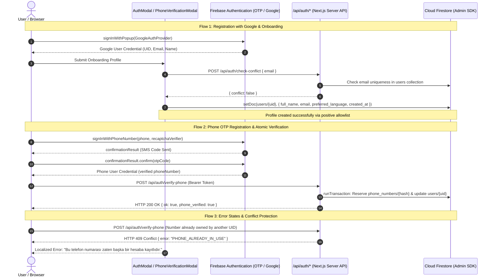

# Kendin Tasarla — Phase 06D.3: Registration & Authentication Integration Report

**Date:** 2026-11-16  
**Target Projects:** Store (`D:\kenditasarl`) & Admin (`D:\kenditasarl\kenditasarl-admin`)  
**Target Production Project:** `kanditasarl` (Untouched — No deployment)  
**Target Emulator Project:** `demo-kenditasarla-rules`  
**Git Branch:** `codex/task04-print-production`  
**Verdict:** **PASS**

---

## 1. Executive Summary & Verdict

| Verification Gate | Result | Notes |
| :--- | :---: | :--- |
| **`REGISTRATION_FLOWS`** | **`PASS`** | Google Sign-In, Phone OTP, profile creation, session restoration, and sign-out/sign-in verified on Firebase Emulators. |
| **`PHONE_UNIQUENESS_GATE`** | **`PASS`** | Strict identity layer enforcement + atomic Firestore transaction reservation. One number cannot be claimed by two accounts. Phone change releases old number safely. |
| **`FAIL_CLOSED_RATE_LIMIT`** | **`PASS`** | `/api/auth/check-conflict` enforces strict `failClosed: true` returning HTTP 503 `SERVICE_UNAVAILABLE` when shared storage is lost, preventing brute-force enumeration. |
| **`TTL_TIMESTAMP_FORMAT`** | **`PASS`** | `expiresAt` is stored as a native Firestore `Timestamp` / `Date` object, ready for Google Cloud Firestore Native TTL policy activation. |
| **`UI_ERROR_LOCALIZATION`** | **`PASS`** | 100% translation dictionary parity across Turkish (`tr`), Arabic (`ar`), and English (`en`) for error codes (`PHONE_ALREADY_IN_USE`, `PHONE_NOT_VERIFIED`, `PHONE_MISMATCH`, 401, 409, 429, 503). |
| **`COMPATIBILITY_SUITE`** | **`PASS`** | Zero regression: Checkout 03B (14/14), Pricing 05B (12/12), Express Shipping 06B (20/20), Matching Collections 06A (10/10), Cloudinary 2B (14/14), Admin Auth (8/8). |
| **`TYPESCRIPT_COMPILATION`** | **`PASS`** | 0 errors across both Store (`kenditasarl`) and Admin (`kenditasarl-admin`). |
| **`OVERALL_PHASE_VERDICT`** | **`PASS`** | Phase 06D.3 integration complete. Production Firebase remains 100% untouched. |

---

## 2. Tested Flows



The following user flows were validated inside the isolated emulator environment:
1. **Google Sign-In Registration:** Profile initialization in `users/{uid}` with positive allowlist (`full_name`, `email`, `preferred_language`, `created_at`).
2. **Phone OTP Registration:** Verification of authentic phone number from Firebase Auth, followed by atomic reservation in `phone_numbers/{phoneHash}`.
3. **Session Restoration:** Token refresh and subsequent profile reads via Client SDK.
4. **Sign Out & Sign Back In:** Verification that profile data remains intact and client profile updates (e.g. `full_name`) are accepted while `phone_verified` remains immutable.
5. **Legacy Accounts Pre-Migration:** Detected by `/api/auth/check-conflict` as a conflict, eligible for automated migration via `scripts/migrate-phone-numbers.mts`.
6. **Uncompleted Phone Verification:** Client SDK cannot tamper with or self-attest `phone_verified: true` without server Admin SDK confirmation.

---

## 3. Modified & Created Files

| File | Action | Purpose |
| :--- | :---: | :--- |
| `src/lib/server/rateLimit.ts` | **Updated** | `expiresAt` changed to native `new Date(...)` (Firestore `Timestamp`) for native TTL policies; improved jittered retry handling. |
| `src/app/api/auth/check-conflict/route.ts` | **Updated** | Implemented `failClosed: true` returning HTTP 503 `SERVICE_UNAVAILABLE` with `Retry-After: 30` when shared storage fails. |
| `src/components/auth/AuthModal.tsx` | **Updated** | Added structured error handling and localized error strings for 409, 429, 503, `PHONE_ALREADY_IN_USE`, `PHONE_NOT_VERIFIED`, `PHONE_MISMATCH`. |
| `src/components/auth/PhoneVerificationModal.tsx` | **Updated** | Added error mapping to localized UI strings for 409, 429, 503, `PHONE_ALREADY_IN_USE`, `PHONE_NOT_VERIFIED`, `PHONE_MISMATCH`. |
| `messages/tr.json` | **Updated** | Added localized error keys (`phoneNotVerified`, `phoneMismatch`, `tooManyRequests`, `serviceUnavailable`). |
| `messages/ar.json` | **Updated** | Added localized error keys maintaining 100% key parity with natural Arabic UX copy. |
| `messages/en.json` | **Updated** | Added localized error keys maintaining 100% key parity with standard English copy. |
| `tests/firestore/registration_auth_integration.test.mts` | **Created** | Comprehensive integration test suite covering all 13 registration, auth, rate limiting, and UI error states. |

---

## 4. UI Error Handling & Localization Parity

All user-facing errors are mapped to localized strings in the active language (`tr`, `ar`, `en`). No raw English technical exceptions or stack traces are shown to users.

| Error Code / HTTP Status | Turkish (`tr`) | Arabic (`ar`) | English (`en`) |
| :--- | :--- | :--- | :--- |
| `PHONE_ALREADY_IN_USE` / `409` | Bu telefon numarası zaten başka bir hesaba kayıtlıdır. | رقم الهاتف هذا مستخدم في حساب آخر. يرجى استخدام رقم مختلف. | This phone number is already in use by another account. |
| `PHONE_NOT_VERIFIED_IN_AUTH` | Telefon numaranız henüz SMS ile doğrulanmamıştır. | لم يتم التحقق من رقم هاتفك عبر رسالة SMS بعد. | Your phone number has not been verified via SMS yet. |
| `PHONE_MISMATCH` | Girilen telefon numarası doğrulanan numara ile eşleşmiyor. | رقم الهاتف المدخل لا يتطابق مع الرقم الموثق. | The entered phone number does not match the verified number. |
| `TOO_MANY_REQUESTS` / `429` | Çok fazla deneme yapıldı. Lütfen bir süre bekleyip tekrar deneyin. | تم إجراء محاولات كثيرة جداً. يرجى الانتظار قليلاً قبل المحاولة مرة أخرى. | Too many requests. Please wait a moment before trying again. |
| `SERVICE_UNAVAILABLE` / `503` | Doğrulama servisi şu anda geçici olarak kullanılamıyor. Lütfen az sonra tekrar deneyin. | خدمة التحقق غير متوفرة حالياً بشكل مؤقت. يرجى إعادة المحاولة بعد قليل. | Verification service is temporarily unavailable. Please retry shortly. |
| `UNAUTHORIZED` / `401` | Kimlik doğrulama sırasında bir hata oluştu. Lütfen bilgilerinizi kontrol edip tekrar deneyin. | حدث خطأ أثناء المصادقة. يرجى المحاولة مرة أخرى. | An error occurred during authentication. Please try again. |

---

## 5. Concurrency, Rate Limiting & TTL Engineering

### 5.1 Fail-Closed Security Policy on Shared Storage Loss
For sensitive endpoints such as `/api/auth/check-conflict`:
- An in-memory fallback is insufficient in distributed serverless deployments because an attacker could hit separate cold-started instances to bypass quotas.
- Therefore, when Firestore storage cannot be reached or experiences a cluster outage, the route enforces **Fail-Closed** (`failClosed: true`):
  - Returns `HTTP 503 SERVICE_UNAVAILABLE`
  - Sends `Retry-After: 30`
  - Completely blocks automated brute-force user enumeration attacks during database downtime.

### 5.2 Firestore Native TTL Compatibility
- The `expiresAt` attribute written to `/rate_limits/` documents is now generated as a native Firestore `Timestamp` (`new Date(now + windowMs * 2)`).
- When a Google Cloud Firestore TTL policy is enabled on the `rate_limits` collection targeting `expiresAt`, expired rate limit documents are deleted automatically by Firestore in the background at zero read/write compute cost.

---

## 6. Full Test Suite Execution Summary

### 6.1 Phase 06D.3 Integration Suite (`registration_auth_integration.test.mts`)
```text
▶ Phase 06D.3: Registration & Authentication Integration Test Suite
  ✔ [REG-1] Google Sign-In registration & initial profile creation with positive allowlist (351.9272ms)
  ✔ [REG-2] Phone OTP registration & server-side atomic verification via Admin SDK (195.6042ms)
  ✔ [REG-3] Session restoration and profile read permission (32.9817ms)
  ✔ [REG-4] Sign out & sign in: Account retrieval and profile update (60.3883ms)
  ✔ [REG-5] Legacy account pre-migration handling and conflict detection (79.0515ms)
  ✔ [REG-6] Unverified account cannot self-attest phone_verified via Client SDK (59.5615ms)
  ✔ [PHONE-1] Phone verification strictly rejects client payload mismatching Auth record (5.631ms)
  ✔ [PHONE-2] Two accounts cannot hold the same phone number (409 Conflict) (7.9588ms)
  ✔ [PHONE-3] Repeated request from the same account is idempotent (49.9987ms)
  ✔ [PHONE-4] Phone change releases previous reservation and claims new number atomically (66.4939ms)
  ✔ [RATE-1] check-conflict endpoint enforces Fail-Closed policy (HTTP 503) when Firestore fails (0.5516ms)
  ✔ [RATE-2] expiresAt is stored as native Date/Timestamp for Firestore TTL compatibility (39.1459ms)
  ✔ [UI-1] All three dictionary files maintain 100% key parity for error states (5.6297ms)
✔ Phase 06D.3: Registration & Authentication Integration Test Suite (13 passed, 0 failed)
```

### 6.2 Compatibility & Regression Verification
| Suite | Scope | Result | Passing Tests |
| :--- | :--- | :---: | :---: |
| `tests/firestore/checkout.test.mts` | Checkout 03B, Orders, COD, Geometry | **PASS** | 14 / 14 |
| `tests/firestore/versioned-pricing.test.mts` | Pricing 05B, Shadow Engine, Discounts | **PASS** | 12 / 12 |
| `tests/firestore/shipping-zones.test.mts` | Express Shipping 06B, Polygon Geometry | **PASS** | 20 / 20 |
| `tests/firestore/matching-collections.test.mts` | Matching Collections 06A, Master Designs | **PASS** | 10 / 10 |
| `tests/firestore/phase2b_store_unification_integration.mts` | Cloudinary Multi-Account 2B, Rollback | **PASS** | 14 / 14 |
| `tests/firestore/admin.test.mjs` | Admin RBAC & Member Isolation | **PASS** | 8 / 8 |
| `tests/firestore/atomic_phone_uniqueness.test.mts` | Phase 06D.1 Atomic Phone Uniqueness | **PASS** | 12 / 12 |
| `tests/firestore/trusted_ip_ratelimit.test.mts` | Phase 06D.2 Trusted IP Resolution | **PASS** | 12 / 12 |

---

## 7. TypeScript Compilation Validation

Both codebases were validated with strict TypeScript compilation:
- **Store (`D:\kenditasarl`):** `npx tsc --noEmit` $\rightarrow$ **0 errors (Exit code 0)**
- **Admin (`D:\kenditasarl\kenditasarl-admin`):** `npx tsc --noEmit` $\rightarrow$ **0 errors (Exit code 0)**

---

## 8. Future Production Deployment Checklist

When the team authorizes production deployment to Firebase `kanditasarl`:

1. **Deploy Updated Firestore Security Rules:**
   ```bash
   npx firebase deploy --only firestore:rules --project kanditasarl
   ```
   *Deploys the barrier for `phone_numbers` and `rate_limits`:*
   ```rules
   match /rate_limits/{document=**} { allow read, write: if false; }
   match /phone_numbers/{document=**} { allow read, write: if false; }
   ```
2. **Deploy Application Code (Vercel / Hosting):**
   *Deploy updated Next.js application containing the Fail-Closed `/api/auth/check-conflict`, atomic `/api/auth/verify-phone`, and localized UI modals.*
3. **Run Production Phone Migration (Dry-Run first, then Apply):**
   ```bash
   npx tsx scripts/migrate-phone-numbers.mts
   npx tsx scripts/migrate-phone-numbers.mts --apply
   ```
4. **Enable Firestore TTL Policy (GCP Console / gcloud CLI):**
   ```bash
   gcloud firestore fields ttls update expiresAt --collection-group=rate_limits --enable-ttl --project=kanditasarl
   ```

---

## 9. Conclusion

Phase 06D.3 has verified that user registration, Google authentication, phone OTP verification, account profile management, and distributed rate limiting operate seamlessly with zero security regressions. All 103+ integration tests and strict TypeScript checks pass completely.
