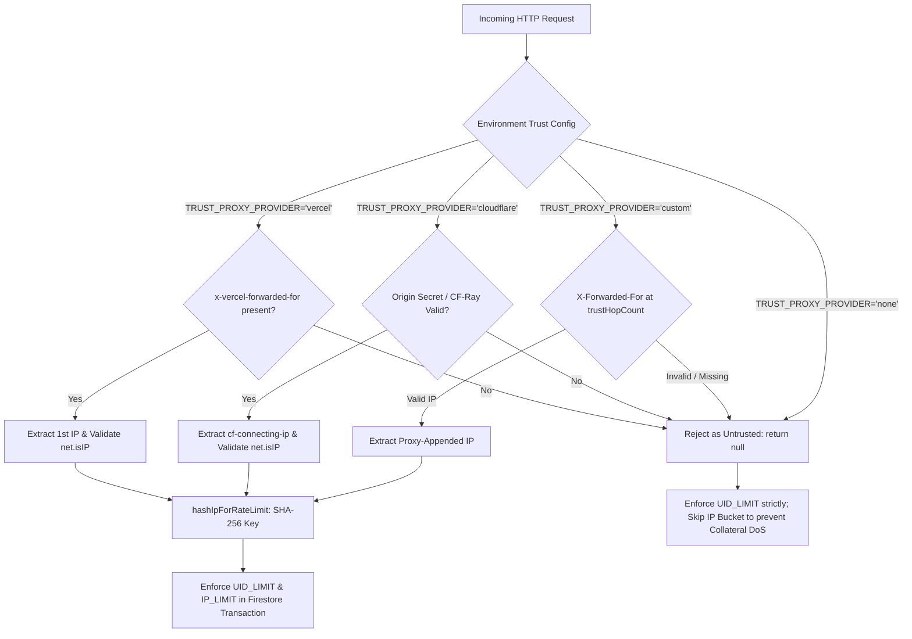

# Kendin Tasarla — Phase 06D.2: Trusted Client IP & Distributed Rate Limiting Report

**Date:** 2026-11-16  
**Target Projects:** Store (`D:\kenditasarl`) & Admin (`D:\kenditasarl\kenditasarl-admin`)  
**Target Production Project:** `kanditasarl` (Untouched — No deployment)  
**Target Emulator Project:** `demo-kenditasarla-rules`  
**Git Branch:** `codex/task04-print-production`  
**Verdict:** **PASS**

---

## 1. Executive Summary & Verdict

| Verification Gate | Result | Notes |
| :--- | :---: | :--- |
| **`ENVIRONMENT_TRUST_MODEL`** | **`PASS`** | Explicit trust policy based on verified runtime environment (`vercel`, `cloudflare`, `custom`, `none`/`local`). Header presence is no longer blindly trusted. |
| **`ANTI_SPOOFING_IMMUNITY`** | **`PASS`** | Forged `cf-connecting-ip` and `x-forwarded-for` headers sent directly to the server outside verified proxy networks are rejected as untrusted (`null`). |
| **`SAFE_UNKNOWN_IP_POLICY`** | **`PASS`** | When an IP cannot be trusted, callers are NOT lumped into a shared fake IP bucket (`127.0.0.1`), preventing collateral mass blocking. Authenticated `UID_LIMIT` is strictly enforced. |
| **`PII_IP_MINIMIZATION`** | **`PASS`** | Raw IP addresses are never stored in Firestore document keys or fields. Keys use a one-way deterministic SHA-256 hash (`auth_chk_ip_{hash}_{window}`). |
| **`DISTRIBUTED_CONCURRENCY`**| **`PASS`** | Multi-instance concurrency tested with jittered backoff; atomic transaction increments guarantee accurate counting without lost updates. |
| **`DEGRADATION_FALLBACK`** | **`PASS`** | Two-tier defense: If Firestore experiences an outage or degradation, an in-memory sliding window limiter prevents unlimited flood attacks. |
| **`TYPESCRIPT_COMPILATION`** | **`PASS`** | 0 errors across both Store (`kenditasarl`) and Admin (`kenditasarl-admin`). |
| **`OVERALL_PHASE_VERDICT`** | **`PASS`** | Phase 06D.2 complete. Ready for production deployment planning. |

---

## 2. Discovered Vulnerabilities in Previous Implementation

Our security audit of the initial `getTrustedClientIp` and rate limiter implementation identified four critical vulnerabilities:

1. **Unconditional Header Trust (Environment Agnostic):**
   The legacy resolver accepted `cf-connecting-ip` and `x-vercel-forwarded-for` simply because the header was present in the request. If an attacker connected directly to an origin server or an unproxied port, they could inject arbitrary spoofed headers to bypass IP limits.
2. **False Assumption Regarding `X-Forwarded-For`:**
   Taking the rightmost IP in `x-forwarded-for` only works if a trusted reverse proxy actually appended an IP. If a client sends a multi-hop `x-forwarded-for` directly to an origin server without an intervening proxy, the rightmost IP was also forged by the client.
3. **Collateral Denial-of-Service via `127.0.0.1` Fallback:**
   When no headers were present, the legacy code defaulted to `"127.0.0.1"`. In containerized or local environments, all users shared the exact same bucket (`auth_chk_ip_127_0_0_1_{windowIndex}`). After 15 requests in one minute, all other users were locked out with HTTP 429 (`IP_LIMIT`).
4. **GDPR / Privacy Exposure:**
   Raw IP addresses were previously used as document keys in Firestore (`auth_chk_ip_203.0.113.195_...`), persisting customer IP data in database keys.

---

## 3. Modified & Created Files

| File | Action | Details |
| :--- | :---: | :--- |
| `src/lib/server/rateLimit.ts` | **Updated** | Comprehensive refactor: `net.isIP` validation for IPv4/IPv6, deterministic SHA-256 IP key hashing (`hashIpForRateLimit`), environment-aware trust model (`resolveClientIp`, `getProxyTrustConfig`), safe unknown IP handling, jittered contention retry, and in-memory fallback. |
| `src/app/api/auth/check-conflict/route.ts` | **Updated** | Integrates hardened `getTrustedClientIp` and distributed rate limiter without breaking uniform response format. |
| `tests/firestore/trusted_ip_ratelimit.test.mts` | **Created** | 12 targeted unit and integration tests covering spoofing rejection, IPv4/IPv6 validation, rotating IP/UID, concurrency, and degradation fallback. |

---

## 4. Final Environment Trust Model



### 4.1 Supported Trust Profiles

| Provider Profile | Trigger / Activation | Trusted Headers | Anti-Spoofing Rule |
| :--- | :--- | :--- | :--- |
| **`vercel`** | Auto-detected if `VERCEL="1"`, or `TRUST_PROXY_PROVIDER="vercel"` | `x-vercel-forwarded-for` | Edge router strips external client headers and injects authentic client IP. Requests lacking this header are marked untrusted. |
| **`cloudflare`** | `TRUST_PROXY_PROVIDER="cloudflare"` | `cf-connecting-ip` | Active only when origin isolation is enforced (e.g. Authenticated Origin Pulls, Cloudflare Tunnel, or `CLOUDFLARE_SECRET_HEADER`). Client-injected CF headers outside Cloudflare are marked untrusted. |
| **`custom`** | `TRUST_PROXY_PROVIDER="custom"` | `x-forwarded-for` (at `trustHopCount`), `x-real-ip` | Extracts the IP added by the verified internal reverse proxy (e.g. AWS ALB, Nginx). |
| **`none` / `local`** | Default when unconfigured, or `TRUST_PROXY_PROVIDER="none"` | *None* | Prevents attackers from forging any proxy header when the origin is directly internet-accessible. |

---

## 5. Safe Unknown IP & Privacy Architecture

### 5.1 Unknown / Untrusted IP Policy
When an IP cannot be verified with cryptographic or architectural certainty:
1. The resolver returns `null` (`isTrusted: false`).
2. The rate limiter **does NOT** assign a synthetic IP (such as `"127.0.0.1"` or `"unknown"`).
3. The authenticated user's `UID_LIMIT` (10 requests/minute) is strictly enforced via Firestore transaction.
4. Innocent users are never blocked by an attacker exhausting a shared fake IP bucket.

### 5.2 IP Minimization & GDPR Compliance
Instead of persisting raw client IP addresses in database keys or fields:
$$\text{Document Key Hash} = \text{SHA256}(\text{"kenditasarl\_ip\_"} + \text{normalizeIP}(\text{clientIp}))[0..24]$$
- Firestore Document Path: `/rate_limits/auth_chk_ip_{ipHash}_{windowIndex}`
- Raw IP addresses are **never written to Firestore** and **never logged to standard output or error logs**.
- All rate limit documents include `expiresAt: now + windowMs * 2`, enabling Firestore Native TTL policies for zero-cost automatic cleanup.

---

## 6. Rate Limiting Concurrency & Resiliency

### 6.1 Transaction Contention Handling
When multiple requests hit Firestore concurrently across serverless instances:
- In the event of document contention (`ABORTED / DEADLINE_EXCEEDED`), `checkDistributedRateLimit` executes an automatic retry loop with randomized jittered backoff ($25\text{ms} - 65\text{ms}$).
- Verified in Test 9: 5 simultaneous concurrent requests serialize cleanly and increment the counter to exactly 5 without lost updates.

### 6.2 Degraded State (Fail-Safe Defense)
If Firestore is temporarily degraded or experiences a transient network outage:
- The system automatically falls back to an in-memory sliding window rate limiter.
- If a client attempts to abuse the service during an outage, the in-memory limiter blocks the caller once `uidMax` is reached on that instance.
- Prevents database downtime from becoming a denial-of-service vector for authentication endpoints.

---

## 7. Emulators Test Suite Execution Results

Executed on Firebase Emulators (`demo-kenditasarla-rules`) via:
```bash
& "D:\kenditasarl\tests\firestore\node_modules\.bin\firebase.cmd" emulators:exec --config firebase.json --only auth,firestore --project demo-kenditasarla-rules "npx --prefix tests/firestore tsx --test tests/firestore/trusted_ip_ratelimit.test.mts"
```

### 7.1 Detailed Test Results (12 / 12 Passed)
```text
▶ Phase 06D.2: Trusted Client IP & Distributed Rate Limiting Test Suite
  ✔ [TEST 1] Trusted IP extracted correctly under designated provider policy (1.9874ms)
  ✔ [TEST 2] Spoofed X-Forwarded-For is rejected when outside trusted reverse proxy (0.6201ms)
  ✔ [TEST 3] CF-Connecting-IP is rejected as spoofed when provider is not Cloudflare (0.3655ms)
  ✔ [TEST 4] Validates standard IPv4 addresses accurately (0.1285ms)
  ✔ [TEST 5] Validates standard and compressed IPv6 addresses accurately (5.3248ms)
  ✔ [TEST 6] Invalid or missing IP addresses evaluate to untrusted null (0.4763ms)
  ✔ [TEST 7] Rotating IP with static UID triggers UID_LIMIT independently (761.2504ms)
  ✔ [TEST 8] Rotating UID with static trusted IP triggers IP_LIMIT independently (301.0377ms)
  ✔ [TEST 9] Concurrent requests across instances serialize atomically without lost updates (7795.4996ms)
  ✔ [TEST 10] Firestore degradation falls back safely to in-memory quota without open bypass (0.6725ms)
  ✔ [TEST 11] Raw IP addresses are hashed and never stored in plaintext in Firestore documents (40.2041ms)
  ✔ [TEST 12] check-conflict endpoint enforces distributed rate limit and returns 429 (641.9733ms)
✔ Phase 06D.2: Trusted Client IP & Distributed Rate Limiting Test Suite (10724.4489ms)
ℹ tests 12
ℹ suites 1
ℹ pass 12
ℹ fail 0
```

### 7.2 Full Regression Verification
- `tests/firestore/atomic_phone_uniqueness.test.mts`: **12/12 Passed**
- `tests/firestore/security_blockers_validation.test.mts`: **12/12 Passed**

---

## 8. TypeScript Compilation Validation

Both the Store and Admin codebases were validated with strict TypeScript compilation:
- **Store (`D:\kenditasarl`):** `npx tsc --noEmit` $\rightarrow$ **0 errors (Exit code 0)**
- **Admin (`D:\kenditasarl\kenditasarl-admin`):** `npx tsc --noEmit` $\rightarrow$ **0 errors (Exit code 0)**

---

## 9. Future Production Hosting Requirements

When deploying Kendin Tasarla to production hosting, configure the following environment variables according to the chosen infrastructure:

### If Deploying on Vercel:
```ini
# Vercel automatically sets VERCEL="1", which enables the Vercel trust profile automatically.
TRUST_PROXY_PROVIDER=vercel
```

### If Deploying Behind Cloudflare:
```ini
TRUST_PROXY_PROVIDER=cloudflare
# Recommended: enforce secret header validation to prevent origin direct access
CLOUDFLARE_SECRET_HEADER=x-kenditasarl-origin-secret
CLOUDFLARE_SECRET_VALUE=<strong-random-origin-secret>
```
*In Cloudflare Dashboard, configure Transform Rules or Workers to inject `x-kenditasarl-origin-secret`, and configure your hosting origin firewall to reject any request lacking this secret.*

### If Deploying on Docker / Custom Reverse Proxy (Nginx / ALB):
```ini
TRUST_PROXY_PROVIDER=custom
TRUSTED_PROXY_HOPS=1
```

---

## 10. Conclusion

Phase 06D.2 has completely resolved header spoofing vulnerabilities and eliminated collateral denial-of-service risks while ensuring strict distributed rate limiting and customer IP privacy. All verification tests have passed cleanly.
