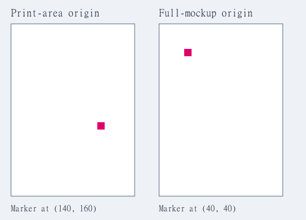

# المرحلة الرابعة — توافق إحداثيات Canvas وملفات الطباعة

15 نوفمبر 2026 · تحقق محلي ببيانات اصطناعية · **الحالة: توقف التنفيذ عند شرط التوافق.**

أثبت الاختبار أن لقطة طلب ثابتة من صيغة 03B يمكن أن تمثل موضعين مختلفين للطباعة. لذلك توقفت قبل تعديل المحرر أو مُصدّر الإنتاج. بقيت مشكلتا تصنيف الصور المفقودة واكتمال ZIP قائمتين في التطبيق. لا يثبت هذا الفحص أن طلبًا فعليًا بعينه متأثر. لم تُقرأ طلبات العملاء ولم يحدث نشر أو ترحيل أو اتصال بإنتاج Firebase أو Cloudinary.

## الدليل من تاريخ المشروع

| الموضع في Git | ما فعله المحرر | ما حفظه |
|---|---|---|
| المتجر عند `a93b45f` | ضبط حجم Canvas على `currentPrintArea.width/height` | عناصر Fabric، مع `snapshotVersion:1` و`editorVersion:1` |
| المتجر عند `8fa876e`، قبل توحيد الإحداثيات | طرح `currentPrintArea.left/top` من موضع الموكاب. أضاف حاشية عرض تبلغ 45% وحرك الـviewport بمقدارها | استخدم مسار الحفظ `canvas.toJSON(['name','originalAssetId'])`. الحاشية تخص العرض ولا تُضاف إلى مواضع العناصر المحفوظة |
| المتجر عند `d415ec3` | جعل Canvas يغطي الموكاب كاملًا، ألغى الحاشية، وأصبح `fabricLeft = mockupX` و`fabricTop = mockupY` | استمر مسار الحفظ نفسه ورقما الإصدار نفسيهما |
| المتجر الحالي | يستخدم الأبعاد الأصلية للموكاب، ويسجّل العرض والارتفاع في الأوجه التي يُسلسلها المحرر الحديث. للفّ الكوب سطح مستقل 1840 × 760 بكسل | قد تبقى للأوجه الموروثة بيانات أقدم. رقم إصدار اللقطة وحده لا يحدد أصل الإحداثيات لكل وجه |

يمكن إعادة فحص نقطة التحول بالأمر `git diff 8fa876e d415ec3 -- src/components/editor/FabricCanvas.tsx`. لا تكفي معرفة تاريخ إنشاء **الطلب** لمعرفة أي محرر أنشأ كل وجه في **التصميم**.

## التجربة الفاصلة

استخدم الاختبار متصفح Chrome ومكتبة Fabric 5.3.0 الموجودة بالمشروع. تحاكي العينة تيشيرت بوجهين ومنطقة طباعة 200 × 280 بكسل، بدايتها عند (100،120) من موكاب 2000 × 2000 بكسل. أبعاد الورق التجريبية 5.08 × 7.112 سم عند 100 DPI، أي بكسل ملف واحد لكل بكسل في المنطقة. وُضعت علامة اصطناعية عند (140،160). العلامة داخل المستطيل في كلا التفسيرين، ولذلك لا يكشف اختبار «هل تقع داخل الحدود؟» الخطأ.

| تفسير الإحداثيات | الموضع الصحيح للعلامة داخل ملف الطباعة |
|---|---|
| أصل منطقة الطباعة | (140،160) |
| أصل صورة المنتج | (40،40) |

بلغ الفارق **2.54 سم أفقيًا و3.048 سم عموديًا**. نفّذ الاختبار عمليتي حفظ باستخدام Fabric، وأثبت تطابق JSON. ثم مرر تصميمين بمرجعي عرض مختلفين إلى دالة `artwork` الفعلية من 03B وتحقق من تطابق كائن الفن المجمد والبصمة لكلا الوجهين. تحقّق أيضًا من بقاء المدخلات كما كانت. بصمة التصميم تثبت المحتوى، ولا تستعيد معلومة الأصل التي لم تسجّل فيه.

فُك ترميز صور Chrome بواسطة Sharp، وفُحصت قيم الشفافية عند الموضعين. وبالمعاينة البصرية ظهرت العلامة في الوسط باتجاه اليمين في حالة منطقة الطباعة، وقرب أعلى اليسار في حالة الموكاب. الخلفية البيضاء والعناوين أضيفت للوحة المقارنة فقط.



## ما تقرؤه مسارات الإنتاج

- يحتفظ عنصر 03B بـ`schema_version` و`art_version` و`is_immutable_snapshot` و`canvas_json` و`production_snapshot` وبيانات اللون والمقاس والطريقة والمواضع. يوجد `preview_images` بصورة منفصلة. تُقرأ مفاتيح تاريخية مثل `red:::front` ثم يُجسّد 03B وجه السطر تحت اسم مثل `front`. قد يكون محتوى الوجه نفسه سلسلة JSON داخل الخريطة المسلسلة. يسقط مُثبّت الفن طبقات النظام المعروفة ويحتفظ بأصل الصور التي تحقق منها. راجع `src/lib/server/checkoutArt.ts` و`src/lib/server/checkout.ts`.
- `printAreas[face]` و`customization_config.faces[face].printArea` يحملان مستطيلًا بصيغة `left/top/width/height`. وقد توجد `nativeWidth/nativeHeight` وأبعاد بالسنتيمتر و`targetDPI` و`printMethod` وحاشية بالملّيمتر و`safeArea`. للموضع المعاير مستطيل مستقل بصيغة `x/y/width/height` ومرجع أصلي وقد يحمل مقاسه الفعلي. يحوّل `placementBounds.ts` هذا المستطيل إلى مساحة الموكاب. يختص `coordinateMapping.ts` أيضًا بالتحويل بين العرض والصورة الأصلية. هذه البيانات تصف المستطيل، لكن المستطيل وحده لا يحدد أين كان أصل عناصر رسم تاريخية.
- تزوّد صفحة طلب الإدارة مولد الإنتاج ببيانات السطر للطلبات الجديدة. مع ذلك، يحاول `ProductionFileGenerator.tsx` قراءة الأصول والمنتج الحاليين، ويتيح الرجوع إلى مقاسات افتراضية. يختار أحيانًا غلاف الوجه قبل `.printArea` المتداخلة. ينبغي فصل إنتاج السطر الثابت عن مسار المعاينة والتوافق القديم. كما يحاول مكوّن الإنتاج تسجيل المحاولات بتحديث مباشر للطلب، بينما قواعد 03B تحجب هذا النوع من الكتابة من العميل.
- يستخدم `production-renderer.ts` معامل العرض وحده و`setZoom`، دون تحويل مستقل لأصل كل مستطيل. ويحذف خلفية Canvas بعد التحميل، ولا يشكّل ذلك وحده تحققًا من كل طبقة موكاب داخل مجموعة. يقوم `fonts.ts` بالبحث عن عدد محدود من الخطوط في عناصر المستوى الأول. لم يُعتمد دعم النص العربي والتركي أو التحويلات المركبة في ملفات الإنتاج بهذا الاختبار.

## المشكلات التي أُعيد إنتاجها

| الفحص على شيفرة الإدارة الحالية | النتيجة |
|---|---|
| صورة اصطناعية ذات عنوان محجوب، وتعذر تحميلها في جميع المحاولات | أعادت `checkDesignQuality` الحالة **READY**. مسار الخطأ في `production-quality.ts` يعيد أبعادًا افتراضية 1200 × 1200. فشل معيار القبول. |
| ملف PNG صالح وصورة أصلية مطلوبة تعذر جلبها | فُتح ZIP الناتج فعليًا. أشار `production-info.json` إلى **ملف واحد مفقود**. يضيف `production-zip.ts` اسم الأصل إلى البيان قبل التحقق من إدراجه. فشل معيار القبول. |
| لفّ كوب بطول 23 سم وارتفاع 9.5 سم، من سطح 1840 × 760 عند 300 DPI | أعاد المُصدّر PNG حجمه **2717 × 1122 بكسل** عند فك ترميزه. يثبت هذا مقاس الملف فقط. لم يُعتمد موضع الوصلة أو الانعكاس أو ناتج طباعة مادية. |

**أثر ذلك على التشغيل:** لا تكفي حالة `READY` أو وجود ملف ZIP حاليًا للإفراج عن طباعة طلب ذي أصل مفقود أو إحداثيات ملتبسة. بقي إصلاح هذه المسارات وتطبيق `NOT_READY` في الواجهة ضمن العمل المعلّق.

## حالة المستودعين والملفات

كان المستودعان على `codex/task03b-secure-checkout`. رأس المتجر `bc85ca6` ورأس الإدارة `15be381`. أظهر `git status` تغييرات غير مثبتة وملفات غير متتبعة من المراحل السابقة. أُنشئ في كل مستودع فرع محلي باسم `codex/task04-print-production` على الرأس نفسه مع الاحتفاظ بشجرة العمل. الفرع وحده ليس نسخة احتياطية من الملفات غير المثبتة.

شمل خط الأساس في المتجر قواعد Firebase وإعداداته، الحزم والقواميس، صفحات المنتج والسلة وCheckout والتأكيد، واجهات السلة والتوصيل والإشعارات والرفع، محرر Fabric ومصفوفة المتغيرات، وكود Firebase والخادم واختبارات المراحل السابقة. وفي الإدارة شمل الحزم والتخطيط والدخول، صفحات الطلبات والمنتجات والتسعير وCloudinary، ومسارات الخادم والرفع والإشعارات والقواميس.

أضافت المهمة الملفات الآتية فقط في المتجر. لم يُعدّل أي ملف تطبيق أو قاعدة أمن أو تبعية أو ملف في لوحة الإدارة.

- `tests/production/phase4-compatibility.mts` — تجربة قابلة للتكرار، وفحص للشفافية ولأبعاد PNG ولعضوية الملفات في الأرشيف.
- `docs/production/phase4-coordinate-proof.png` — مقارنة اصطناعية للموضعين.
- `docs/production/PHASE4_CANVAS_PRODUCTION_COMPATIBILITY_REPORT.md` — هذا التقرير.

## نتائج التحقق المحلي

| المجموعة | النتيجة |
|---|---|
| مقارنة الإحداثيات وتثبيت لقطة 03B | نجح اختبار التشخيص. نجاحه يثبت وجود الالتباس. |
| هندسة المتجر ومحرر مناطق الطباعة في الإدارة | نجحت 10 حالات في المتجر و5 في الإدارة. |
| محاكيا Auth وFirestore بمشروع تجريبي | 29/29. منها 8 للمرحلة 01، و7 للمرحلة 02، و2 للتوافق من 03، و12 للمرحلة 03B. |
| Checkout في Chrome على محاكٍ جديد | 1/1. وافق المشتري التجريبي على السعر المعاد حسابه وانتهى المسار بطلب دفع عند الاستلام واحد. |
| TypeScript | نجح في المتجر ولوحة الإدارة. |
| بناء Next.js | نجح المتجر ولوحة الإدارة من نسخ مصدر معزولة بإعدادات اختبار. |

أُجريت اختبارات الحساب وPNG وZIP على أشكال صُنعت للاختبار. لم تُعتمد مطابقة القص والانعكاس على جميع الأوجه، أو جودة DPI للصور المتداخلة والمحورة، أو الخطوط العربية والتركية، أو حدود النزف. لا توجد نتيجة تحقق طابعة أو ملف ICC/DTF فعلي ضمن هذه الجولة.

الأوامر التنفيذية، من جذر المتجر ما لم يذكر غير ذلك:

```powershell
node tests/firestore/node_modules/tsx/dist/cli.mjs --test tests/production/phase4-compatibility.mts
node tests/firestore/node_modules/tsx/dist/cli.mjs --test src/lib/coordinateMapping.test.ts kenditasarl-admin/src/lib/printAreaEditor.test.ts
node tests/firestore/checkout-build.mjs store
node tests/firestore/checkout-build.mjs admin
# من جذر كل تطبيق
.\node_modules\.bin\tsc.cmd --noEmit --incremental false
# من tests/firestore
.\node_modules\.bin\firebase.cmd emulators:exec --config ../../firebase.json --only auth,firestore --project demo-kenditasarla-rules "node node_modules/tsx/dist/cli.mjs --test --test-concurrency=1 admin.test.mjs cloudinary.test.mts checkout-pricing-audit.test.mts checkout.test.mts"
.\node_modules\.bin\firebase.cmd emulators:exec --config ../../firebase.json --only auth,firestore --project demo-kenditasarla-rules "node node_modules/tsx/dist/cli.mjs --test checkout.browser.mts"
```

## خيارات الاستئناف

1. **المسار الموصى به للتصاميم الجديدة:** إصدار صريح لكل وجه يثبت نوع المرجع وقياسه، ومستطيلات المواضع ومعايرتها ومقاس كل مخرج وطريقة الطباعة والانعكاس. يسجّله الكاتب الذي يعرف أصل الرسم ثم يثبته الخادم داخل سطر الطلب. يُعالج الفن الموروث غير الموسوم بوصفه قديمًا حتى لو اشتُري اليوم. يعرض القارئ `NEEDS_REVIEW` عند نقص الدليل، وتوقف أخطاء الصور والخطوط أو الأرشيف إصدار حزمة جاهزة.
2. **للحفاظ على الطلب التاريخي عند توفر مرجع مستقل:** تقارن جهة الإنتاج المعاينتين بعينة معتمدة تثبت القياس والموضع لكل وجه. يُحفظ قرار المراجع كملحق منفصل مرتبط ببصمة سطر الطلب. تظل اللقطة الأصلية والسعر والعداد والمخزون محفوظة.
3. **عند غياب المرجع أو اختلافه:** يُطلب اعتماد نسخة تصميم جديدة تحمل معايرة صريحة قبل الطباعة. تبقى النسخة التاريخية قابلة للقراءة والمراجعة.

بعد تنفيذ المسار المختار، تكون خطوة 04B المناسبة مقارنة ملفات PNG والحزم بصريًا في بيئة مرحلية مضبوطة ثم طباعة عينة تيشيرت وكوب، مع توثيق المقاس وموضع الوصلة وقرار الانعكاس.
